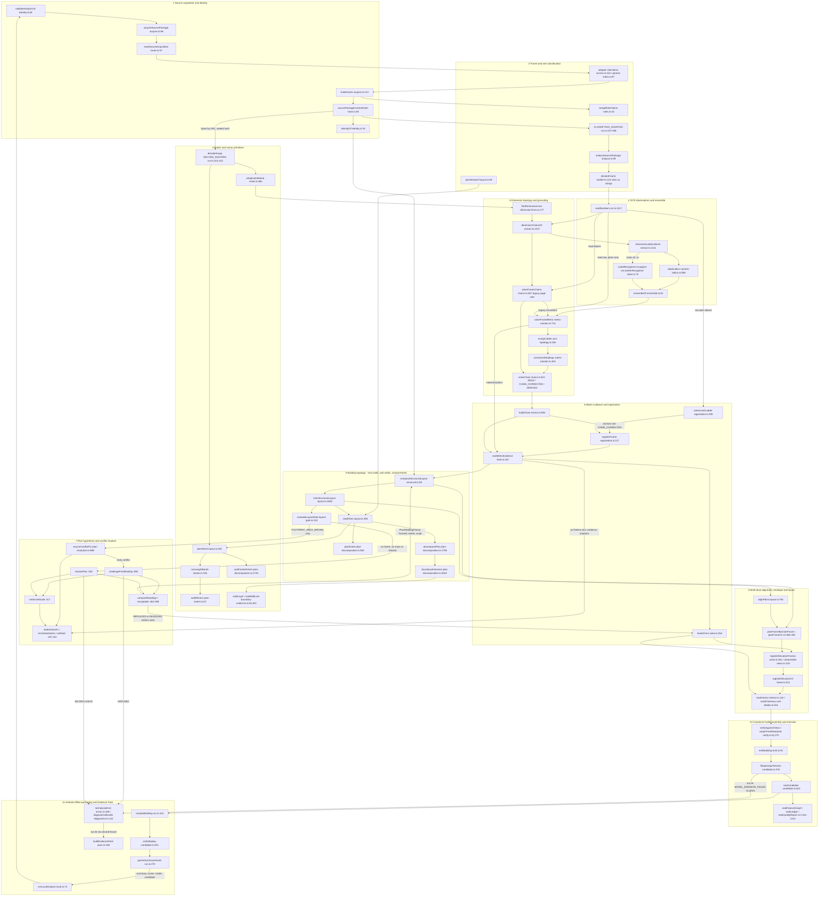

# 005P — current system map (as built at 5906afa)

**Why the analyzer works on some houses and fails on others, in system terms:**

1. Every frame role (storey, which copy is "dimensioned", elevation side, section) is a publisher-route string (slug, caption, HTML channel) merged by maximum confidence at acquisition and never checked against pixels; copies of one drawing carry no lineage, so they rank first by a channel proxy and corroborate each other as independent assets.
2. Scale *proposals* are ensemble-aware (`DimensionObservation` reads `readingOf`), but the sealed `MetricEvidence` keeps the classic token text, legacy page-vote chains survive unless a re-read READs more, and plan resolution's as-printed view (`firstReadCm`, `zeroSubstitution`) is reader-blind and legacy-biased — so the weakest reader can accuse and refuse a STRONG/CONFIRMED scale (glogownikach).
3. Scale-chosen values (CHAIN_CORRECTED segments, OTHER_AXIS_SCALE orientations, ladder rungs) anchor the registration that restates that scale, so a self-anchored legacy scale seals as a confident registration (murajach 2.451 cm/px); plans with no independent reading stop as METRIC_RESOLUTION_INCONCLUSIVE with the resolver at NO_ALTERNATIVE (D01–D05, aster-viii, galaktyka).
4. Ranking treats absence as agreement (`refutedShare = 0` when nothing is stated) and, when the figure is SCORED, ranks the published footprint above every drawing key, so an abstaining view or a figure can move the copy the building is read from (jarzabem under the 005O M1 view).
5. Missing primitives are not repaired (akebiach piers below the band `minLength` → short envelope → PLAN_LAYOUT_REJECTED), and late failures (MODEL_EMISSION_FAILED, SCENE_COMPILE_FAILED, VERIFY_*) lose the plan digest, so an upstream first-bad decision (no ridge datum → no roof → chimney height 0, gozdzikowcach) surfaces in the wrong phase.

**Sources.** `/home/user/work005p/audit-maps.json` (8 subsystem audits), `/home/user/work005p/audit-critic.json` (completeness
critic), `research/analyzer-005p/hypotheses.md` §0, and the 005P frozen-baseline replay outputs under
`/home/user/work005p/runs/P0-frozen` (44 cases; `P0H` byte-identical on all 44 per `cmp-P0frozen-P0H.json`), read only for
failure codes and messages. Markers: **[C]** confirmed by the critic, **[V]** re-checked in code at 5906afa for this map,
**[U]** UNVERIFIED (no input establishes it). Line corrections against the inputs are listed in Appendix A.
Paths are relative to `packages/` unless they start with `apps/`, `tests/` or `research/`.

---

## §1 End-to-end stage order (`analysis-service/src/run.ts` → `reconstruction/src/v2/reconstruct-v2.ts`)

0. **Entry.** `runAnalysis` (run.ts:169): clocks, `TraceRecorder`, checkpoint, heartbeat (:170-206). Callers: phone
   `runLocalAnalysis` (apps/local-analyzer/src/local.ts:73, call at :76), API `executeJob` (apps/analyzer-api/src/executor.ts:35),
   `runLinkAnalysis` (run.ts:622), scripts `second-house.ts:197`, `reconstruct-v2.ts:55`.
1. **ACQUIRING_SOURCE** (run.ts:208-245). URL: `validateAnalysisUrl` (run.ts:215; identity.ts:60) → `acquireSourcePackage`
   (run.ts:218; source-package/src/acquire.ts:68): `fetchBytes`/`safeFetch` (acquire.ts:488, net.ts), `logicalSourceUrl`
   (logical-url.ts:357), `routeSourceAcquisition` (router.ts:57), adapter discovery + `__n+11000` guesses, `probeImage`
   (image.ts:34), `buildAssets` union-find (acquire.ts:213) → `mergeRoleClaims` (roles.ts:43), documents (acquire.ts:443-485),
   `sourcePackageContentHash` (hash.ts:49). PACKAGE: `SourcePackageSchema.parse` (run.ts:235). Thrown SOURCE_* / INVALID_URL /
   UNSUPPORTED_PUBLISHER are mapped in the catch (run.ts:565-567).
2. **CLASSIFYING_SOURCES** (run.ts:247-268). Counts `asset.roles.document`; no FLOOR_PLAN and no ELEVATION → `AnalysisError`
   NO_DRAWINGS / SOURCE_INCOMPLETE, reasonCode PLAN_NOT_FOUND (:263-265). Classifies nothing from pixels.
3. **EXTRACTING_OBSERVATIONS / OBSERVE_ASSETS** (run.ts:271-310). PACKAGE+graph replays the graph unchecked (:281-284) [C].
   Otherwise `analyzeSourcePackage` (:289; source-analyzer/src/analyze.ts:99) with `nullVisionReasoner` default (:288):
   `selectedVariant` (analyze.ts:124), skip CHROME/UNKNOWN (:126-128), `prepareRaster` decode (:138), size check (:148-151),
   `declareFrame` (:154 → source-observations/src/builder.ts:122), extractor by document role (:164-176), `relateAcrossViews`
   (analyze.ts:234 → identity.ts:67).
4. **DECODE_RASTERS** (run.ts:312-322). Second decoder `decodeImage` over every selected variant (CHROME/UNKNOWN included),
   keyed by the sealed `variant.byteHash`; the bindingless `catch` at :320-322 stores `undefined` and discards the cause [C, V].
5. **Identity** (run.ts:324). `identityOf(pkg)` (identity.ts:34) overridden by `options.identity`; slug flows into metrics
   (:369) and reconstruction (:405-407) [C].
6. **METRIC_FRAMES** (run.ts:329-398). `extractMetricEvidenceAsync` (run.ts:364; source-metrics/src/extract.ts:314) steps the
   generator `metricEvidenceSteps` (extract.ts:332) per frame in id order, frames admitted by `DEFAULT_FRAME_FILTER`
   (extract.ts:88-89, every ORTHOGRAPHIC_* projection, SITE_PLAN included):
   1. `readNumbers` (extract.ts:369; ocr.ts:1017) — raw passes only when `isPlan` (extract.ts:368);
   2. `adaptiveInkMask` (extract.ts:381), `findDimensionLines` + `dimensionChainsOf` (extract.ts:386);
   3. `planScalePlausibility` (extract.ts:388, FLOOR_PLAN only);
   4. legacy `solveFrameChains(measured, read.tokens)` (extract.ts:390; chains.ts:567); scale-implausible gap (:392-401);
   5. plans with raw passes only (`if (isPlan && read.raw)`, extract.ts:420): `dimensionLabelLattices` (:424; :1141),
      `labelCrop` (:445), one recogniser yield per plan (:447), `ensembleOf` (:454), `solveFrameMetric` (:459;
      metric-solution.ts:744);
   6. `buildChain` (extract.ts:906) with anchors filtered by `anchorable` (:478-481) and `origin !== 'DERIVED'` (:997);
   7. `solveLevelLadder` (extract.ts:688; registration.ts:295) and ladder anchors (extract.ts:762-770);
   8. `registerFrame` (extract.ts:794; registration.ts:127);
   9. `scaleConflicts` (extract.ts:847 → :1099-1130) and `sealMetricEvidence` (source-metrics/src/hash.ts:167).
   The recogniser is released in `finally` (run.ts:377-384); a failure is EXTERNAL_RECOGNISER_FAILED with no lattice-only
   fallback.
7. **reconstructV2** (run.ts:402; reconstruct-v2.ts:169), phases via `onPhase`:
   1. REGISTRATION (v2:173). `sectionFrame` = first ORTHOGRAPHIC_SECTION frame, `levelsFrom` (v2:228-229; solve.ts:252).
   2. `composeStructuralLayout` (v2:231; structural.ts:59) → `inferStructuralLayout` (layout.ts:1669) → `readPlans`
      (layout.ts:355) → `planSheet` (layout.ts:463), `planExtent` / `wallClusterExtent`, `decomposePlan`
      (plan-decomposition.ts:1796), `alignPlans` (layout.ts:760, call :1751), roofs, `evaluateLayoutGate` (layout-gate.ts:104).
   3. Early conflict: `footprintOnly` (v2:277) → `sourceConflictFor` (v2:278) → `challengeFirstReading` (v2:280):
      REPLACED (v2:282-287) / REFUSED → PLAN_RESOLUTION_INCONCLUSIVE via `metricStop` (v2:288-292) / KEPT.
   4. Else if no world frame, no mass or layout refused (v2:298): `resolvePlan` (v2:300): RESOLVED (v2:302-307) /
      INCONCLUSIVE (v2:308-319, through `boundaryStop(metricStop(..))`) / NO_ALTERNATIVE (first reading's failure stands).
   5. Else late challenge: `firstReadingNeedsChallenge` (v2:329), `sourceConflictFor` (v2:330), `challengeFirstReading`
      (v2:333): REFUSED (v2:335-339) / REPLACED (v2:341-344) / KEPT with conflict → AMBIGUOUS gap (v2:349).
   6. Final gates: no world frame or mass (v2:354-358), layout refused (v2:364-368).
   7. Massing, per-storey frames and pieces (v2:388-496), `registerElevationFrames` (v2:502; solve.ts:302).
   8. TOPOLOGY (v2:531): main roof (v2:532-606), stairs, openings, interior with published rooms (v2:755-782),
      chimneys (v2:945).
   9. METRICS (v2:798): `registerSection` (v2:863).
   10. MODEL (v2:1245): `verifyAgainstViews`/`repairFromResiduals` (verify.ts:42, :270), `emitBuilding` (v2:1256;
       emit.ts:91), `fitOpeningsToHosts` (v2:1271; candidate.ts:376), MODEL_EMISSION_FAILED (v2:1280).
   11. `sealCandidate` (v2:1334; candidate.ts:203), ledger dispositions (v2:1365-1408), `sealFeatureGraph` /
       `sealLedger` / `sealQualityReport` (v2:1411-1413).
8. **Serialize** (run.ts:429-434): `serializeModel` (:431), BUILDING_MODEL SEAL trace.
9. **COMPILING_SCENE** (run.ts:436-451): `compileBuilding` (:441; catch at :442 discards the cause → SCENE_COMPILE_FAILED
   :444), `buildMobileSceneBundle` / `serializeBundle` (:447-448).
10. **VERIFYING** (run.ts:453-480): `verifyReplay` (:456; self-replay of the candidate, not a source check), `loadBundle`
    round trip (:461-465), `geometryClosureAudit` (:470; exterior ERROR findings only DEGRADE the trace, :476-478).
11. **Result** (run.ts:482-564): level counts, `warningsOf` (:486; warnings.ts:76), `LinkAnalysisResult` with hashes.
12. **Any throw** (run.ts:565-586): `toAnalysisError` (:567; errors.ts:169), trace substage `'UNEXPECTED'` when the thrower
    recorded none (:573), `plans` only from `error.plans` (:575), `diagnosticsBundle` (:578; diagnostics.ts:122; its own
    catch at :579 discards the cause), attachments (:584).
13. **Off the product path:** `buildEvidencePack` (evidence-pack/src/pack.ts:168) reads a run directory written by
    `analysis-service/scripts/second-house.ts`; the phone writes `diagnostics/{trace,diagnostics,plan-overlay,performance}`
    (apps/local-analyzer/src/program.ts:75).

---

## §2 Call / data flow across the 11 subsystems

---

## §3 Subsystem contracts

### §3a Entry points, owned decisions, data contract

| # | subsystem | entry points (file:function) | owned decisions (OBSERVES / PROPOSES / DECIDES) | consumes → emits |
| --- | --- | --- | --- | --- |
| 1 | Source acquisition and identity | source-package/src/acquire.ts:68 `acquireSourcePackage`; analysis-service/src/identity.ts:60 `validateAnalysisUrl`, :34 `identityOf`; source-package/src/router.ts:57 `routeSourceAcquisition`; logical-url.ts:357 `logicalSourceUrl`; net.ts `safeFetch`/`assertFetchable`; cache.ts:193 `fileByteCache`; analysis-service/scripts/second-house.ts:95 `secondHouse` | DECIDES fetch safety per hop (https, DNS vs private ranges, 5 redirects, 24 MiB, 20 s idle; net.ts ~52-63); adapter route (router.ts); logical identity `canonicalUrl` and `pkg.id` (acquire.ts:185); fetched addresses and order (maxAssets 120, acquire.ts:126-133); grouping (union-find acquire.ts:213-276, BYTE_IDENTICAL, DIFFERENT_CROP >2 % aspect); selected variant (variants.ts:81-83); content hash (hash.ts:49-62); analysis slug/label (identity.ts:34-40); NO_DRAWINGS stop (run.ts:252-266). OBSERVES pixel size from bytes (image.ts:34), published facts/rooms as text. Never metric. | user URL, `SourceAdapter[]`, `AcquireOptions`, network or cached bytes; PACKAGE JSON → `SourcePackage` (schema.ts:268-316; 1.2.0 / 1.3.0 with documents), `SourceAsset`, `SourceVariant` (byteHash, decoded size), `AcquisitionFailure`, `PublishedFact`/`PublishedRoom`, `AnalysisIdentity` |
| 2 | Frame and role classification | adapters archon.ts:118 `archonRoleClaims`, generic/index.ts:87 `genericRoleClaims`; roles.ts:43 `mergeRoleClaims`, :92 `normalizeRoles`; run.ts:247-268 CLASSIFYING_SOURCES; source-analyzer/src/analyze.ts:99 `analyzeSourcePackage`; builder.ts:122 `declareFrame`; layout.ts:80 `planStoreyOf`, :355 `readPlans`, :583 `chooseBasePlan`; views.ts:243 `chooseSide`; v2:228 `sectionFrame` | DECIDES document/storey/annotation/view/projection from slug, caption, channel, endpoint only (archon.ts:92-172; generic/vocabulary.ts:27-43); per-dimension max-confidence winner, tie → UNKNOWN (roles.ts:43-58); one frame per asset = largest variant (analyze.ts:124); extractor route by document role (analyze.ts:164-176); unlabelled plan = GROUND unless a GROUND exists (layout.ts:80); first-reading copy DIMENSIONED > area > id (layout.ts:380-384); elevation side (views.ts:243-266); section = first by id (v2:228). OBSERVES only cross-view POSSIBLY_SAME_FEATURE (identity.ts:67-145). | `RoleClaim` (roles.ts:19-28), `SourceAsset` → `SourceRoles` + `roleEvidence`; `SourceCoordinateFrame` {assetId, variantByteHash, size, roles as `z.string()`} (source-observations/src/schema.ts:363-373); `SkippedPlan`, `PlanReading`, `ElevationRegistration` |
| 3 | Raster and vector primitives | source-cv/src/mask.ts:366 `adaptiveInkMask`; bands.ts:106 `runLengthBands`, :240/:250 thickness stats; layout.ts:463 `planSheet`; plan-extent.ts:67 `wallWitness`; plan-decomposition.ts:2745 `wallClusterExtent`, :441 `gridLines`, :584 `wallIntervals`, :730 `closureOf`; boundary-evidence.ts:84 `solidLayer`, :304 `readWallLine`, :571 `classifyGap`, :664 `assignCallouts`; gap-evidence.ts:111; image-metrology bounds.ts:270/:365, fuse.ts:101; run.ts:312-322 `decodeImage` | OBSERVES ink (≤110 or 8 levels under local mean, radius max(w,h)/40; mask.ts:367-372) and thick straight runs (bands.ts:112-120). DECIDES collinear merge across openings (gap ≤ 90 px, axis 3 px; bands.ts:65, 198-205), sheet `wallPx` (median, silent 12 px fallback; layout.ts:470), accepted band set (0.45w/1.9w/1.6w; layout.ts:471-475), gap class and strength (boundary-evidence.ts:571-640), callout-to-gap assignment (:684-689). PROPOSES wall witness and wall-mass cluster extents, grid lines. | `Raster`/`Gray`, `BandOptions`, chains (ticks, origin), registration mpp, callout widths → `Mask`, `Band` (segments), `PlanSheet` {mask, bands, wallPx, witness}, `WallWitness`, `GridLine`, `EdgeClosure`, `SolidLayer`, `BoundaryGap`, `GapEvidenceRecord` (≤400); graph `WALL_BAND`/`OPENING_INTERVAL` from source-analyzer extractors/plan.ts:113 (not consumed) |
| 4 | OCR observations and ensemble | ocr.ts:1017 `readNumbers`, :1141 `readNumbersFromInk`, :584 `scoreCell`; numeric-lattice.ts:908 `labelLattice`, :879 `dimensionValueOf`; recogniser.ts:103 `labelCrop`; numeric-recogniser-ort client.ts:70 `workerRecogniser`, engine.ts:178 `openEngine`; ensemble.ts:91 `ensembleOf`, :159 `readingOf`; metric-solution.ts:404 `correctionReadings`; parse.ts:224 `parseNumber`, :301 `readingLattice` | Classic reader DECIDES glyph grouping, cuts, page orientation vote (`dedupeOrientations` ocr.ts:921), PROPOSES ≤3 alternatives per glyph. Lattice PROPOSES ≤8 sequences, DECIDES `asRead` (`pickAsRead` :1302) and `ocrClass`. External recogniser OBSERVES only (top-5 digit beam, greedy, 4 bracket variants). Ensemble DECIDES the metric layer's reading and `rival` (AGREES → CLEAR for any lattice class, ensemble.ts:131-133; CONTESTS / CONTESTS_COUNT → AMBIGUOUS; LEADS → external asRead, :145-155). `correctionReadings` DECIDES ensemble reading = substitutions 0 → origin READ (metric-solution.ts:423; chains.ts:758). parse.ts DECIDES unit convention. | `Raster` → `OcrToken` (schema.ts:169-197; pageVote), `NumericLatticeRecord` (schema.ts:914-1036, with `external`, `ensemble` since 1.6.0), `LabelEnsemble`, `ChainToken.readings`, `DimensionObservation.rawText` = ensemble asRead (metric-solution.ts:532), `MetricEvidence.rawText` = classic token text (extract.ts:949) |
| 5 | Dimension topology and grounding | dimension-lines.ts:177 `findDimensionLines`, :355 `classifyMarks`, :596 `markLabelInk`; extract.ts:1047 `dimensionChainsOf`; axis-topology.ts:89 `measurementChain`, :336 `assignLabels`; chains.ts:567 `solveFrameChains` (legacy), :621 `solveChain`; metric-solution.ts:744 `solveFrameMetric`, :1604 `dimensionHierarchy` | OBSERVES mark classes TICK/QUESTIONABLE/REJECTED (dimension-lines.ts:355). DECIDES measurement points (axis-topology.ts:89), label-to-line assignment by exact Hungarian (axis-topology.ts:336), binding role (metric-solution.ts:289/333), legacy page-vote scale (chains.ts:433, 526), orientation per chain (metric-solution.ts:766-857), witness eligibility (:571, :644, I2 :899, I5 :911), selected hypothesis, relation and confidence (:1210-1225), final per-axis scale (:1228-1251, legacy kept unless REPLACED/ADDED; :1394), substitution values (chains.ts:758), legacy chain kept unless re-read READs more (metric-solution.ts:1300-1327). | `TextToken`/`OcrResult` (tokens and raw), `Mask`, `EnsembledLattice`, legacy `FrameChainSolution`, `ScalePlausibility` → `RawChain`, `LabelAssignment`, `SolvedChain`/`SolvedSegment` (origin), `DimensionObservation` (schema.ts:479-567), `FrameMetricSolution` (schema.ts:637-751: relation, confidence, isotropy, hypotheses ≤6, orientationDecisions) |
| 6 | Metric evidence and registration | extract.ts:906 `buildChain`; registration.ts:127 `registerFrame`, :295 `solveLevelLadder`; extract.ts:1099 `scaleConflicts`; hash.ts:167 `sealMetricEvidence`; solve.ts:252 `levelsFrom`; extract.ts:88 `DEFAULT_FRAME_FILTER` | DECIDES which segments become registration anchors (all but DERIVED, `anchorable` only when the scale stands and the chain was re-read; extract.ts:478-481, 997); registered mpp per axis, seed max weight, 3 px inliers (registration.ts:93-105); ladder line count-first (registration.ts:338); level datum origin (extract.ts:717, UNRESOLVED sealed READ); levels measured vs convention (solve.ts:257). PROPOSES the registered scale downstream treats as THE scale. | segments, ladder candidates → `MetricEvidence` LINEAR_DIMENSION (schema.ts:269-314; rawText, value, origin, alternatives at 0.2, derivation only for CHAIN_CORRECTED or dependsOnScale), LEVEL_DATUM, `CoordinateRegistration` (schema.ts:824; anchors, residual, confidence), `MetricConflict`, `UnresolvedMetric` gaps, sealed `MetricEvidenceSet` (schema 1.7.0/1.8.0), `LevelFacts` |
| 7 | Plan hypothesis and conflict resolver | plan-resolution.ts:530 `resolvePlan`, :959 `challengeFirstReading`, :889 `sourceConflictFor` → :830 `sourceConflictOf`, :920 `firstReadingNeedsChallenge`; internal :187 `statementsOn`, :212 `zeroSubstitution`, :222 `asRead`, :249 `latticeScales`, :283 `metricScales`, :317 `metricsAtScale`, :464 `compareReadings`, :485 `acceptable`; only production caller v2:266-351 | DECIDES the reading after a structural stop (copy ≤4 × extent × scale × merge × faces × mouths); KEPT/REPLACED/REFUSED of a completed first reading; SourceConflict T1/T2/T3 (no figure input, :830); fast path (:920-933); per-scale re-read / refute (`metricsAtScale` :326-342); corroborations ISOTROPY / CROSS_COPY (:416-423); figure use SCORED/SPENT/VERIFIED/NONE (:105, :535, :966); ties named not broken (:722-730). PROPOSES ≤2 lattice scales for pre-1.2.0 evidence; forwards ≤2 metric hypotheses (:283-296). | `StructuralPassOptions` (graph, metrics, publishedAreas, sheetCache), incumbent `StructuralPassResult`, `MetricEvidenceSet` (evidence, `ocrTokens[].text`, chains, registrations, metricSolutions, dimensionObservations for T2 only) → `PlanResolution`, `ChallengeOutcome`, `SourceConflict`, `PlanReadingChoice`, a `metricsAtScale` view replacing `metrics` (same id and contentHash), gate reason PLAN_RESOLVED_BY_HYPOTHESIS, `AlternativeGroup`, LayoutConflict SCALE_DISAGREEMENT |
| 8 | Building topology (host walls / wall solids / compartments) | structural.ts:59 `composeStructuralLayout`; layout.ts:1669 `inferStructuralLayout`; plan-decomposition.ts:962 `planExtent`, :1796 `decomposePlan`, :1479 `collinearWideGaps`, :1647 `baysOf`, :3040 `boundaryExtension`, :2608 `planBodies`; compound-facade.ts:362 `compoundSpanOf`; boundary-outline.ts `solveOutline`; boundary-completion.ts:167 `completeBoundary`; layout-gate.ts:104 `evaluateLayoutGate`; plan-openings.ts:157 `planOpenings` (v1 path) | DECIDES plan extent per copy (chains first, walls only refute; plan-decomposition.ts:962-1195), structural grid, per-edge closure and cell flood BUILT/RECESS/OUTSIDE (:730-781, ~2196-2275), wide gap OPENING_IN_WALL vs OPEN_SIDE incl. pocket test (:2062-2140), enclosure H0 vs H1 (:2190), outline adoption (widen-only), completions, bodies → masses (<35 % wall dropped, layout.ts:1787), mass roles and SHARES_WALL_WITH (layout.ts:2223-2365), gate status incl. footprint >20 % BLOCKING (layout-gate.ts:146-151). NAMES body relations (boundary-bodies.ts). | `Mask`, `Band`, chains, observations, registration, `PlanReadingChoice`, `publishedAreas` (gate only) → `PlanExtent` (per-axis provenance, weak), `PlanDecomposition`, `BoundaryRecord`, `StructuralLayoutHypothesisSet` (BUILT/RECESS/ZONE regions, rectangle masses, facades, gate, contentHash), `LayoutGap`, `SkippedPlan` |
| 9 | Multi-level alignment, envelope and layout | layout.ts:760 `alignPlans` (call :1751); v2:388-424 storey rects/pieces, v2:438-457 `datumOf`, v2:466-494 `planFrameByOuterFaces`/`planFrameV2`; solve.ts:302 `registerElevationFrames` → views.ts:182 `registerElevations`; v2/frame.ts:313 `registerElevationV2`; roof-details.ts `registerSection`, :164 `readChimneys`; v2/interior.ts:134 `readInterior` | DECIDES storey datums and their provenance (SOURCE_EXACT vs ASSUMED_FOR_RENDERING; v2:438-457, top storey stretched to ridge :452); per-storey plan frame (faces win only within 3 % of a STATED/PRINTED_SCALE alignment; v2:79, 482-484); storey pieces (gap <1 m collapsed; v2:77, 393-424); main roof existence (pitched + pitch + `ridgeY`; v2:532-606); elevation side and scale (views.ts:243-266; frame.ts:329-346 mpp from plan width, apex on ridgeY); G1b side mirror (v2:598-615). PROPOSES chimneys (≥2 storeys or a render; roof-details.ts:197). | `StructuralLayoutDraft` (alignments, storeys, storeyRegistrations), `LevelFacts`, graph observations, `publishedRooms` → per-storey frames, `ElevationRegistration`, section registration, `InteriorReading`, chimney readings, gaps MISSING/AMBIGUOUS, DEGRADED trace rows (PLAN_STOREY_ALIGNMENT_FAILED, VIEW_REGISTRATION_NO_ANCHORS as reasonCodes only) |
| 10 | Canonical model assembly and emission | v2/verify.ts:42 `verifyAgainstViews`, :270 `repairFromResiduals`; v2/emit.ts:91 `emitBuilding`; v2/wall-topology.ts:96 `planWallTopology`; candidate.ts:376 `fitOpeningsToHosts`, :203 `sealCandidate`; v2/graph.ts:227, ledger.ts:59, quality.ts:59; failure.ts:134 `ReconstructionFailure` | DECIDES wall/slab/roof/opening/stair topology (emit.ts:139-556), model-object provenance (`evidence()` emit.ts:101, status map :52-69), chimney height default (emit.ts:447), opening shrink/lower/drop on FIT/DROP codes only (candidate.ts:318-327), bounded repair ≤1.2 m of ASSUMED sills/heads (verify.ts:280-298), ledger dispositions (v2:183-190, 1365-1408), quality levels (quality.ts:52-59). OBSERVES via the model validator `applyCommand` (commands/src/apply.ts:131). | `BuildingV2`, `BuildingCommand` schemas (commands.ts; `PlaceChimneySchema` :349, height positive :356) → `EmitResult` {program, bindings}, `OpeningFit[]`, `ReconstructionCandidate`, `CanonicalBuildingModel` (MODEL_SCHEMA_VERSION 1.6.0), feature graph, ledger, quality report, `ReconstructionFailure` MODEL_EMISSION_FAILED |
| 11 | Android offline packaging and Evidence Pack | apps/local-analyzer/src/local.ts:73 `runLocalAnalysis`, program.ts (protocol, `writeDiagnostics`), wiring.ts:29 `bundledRecogniser`, :40 `localWiring`; apps/android .../LocalRuntimeFiles.kt:62; run.ts:441 `compileBuilding`, :456 `verifyReplay` (candidate.ts:251), :470 `geometryClosureAudit`; warnings.ts:76 `warningsOf`; files.ts:28 `analysisFilesOf`; errors.ts:169 `toAnalysisError`; diagnostics.ts:122 `diagnosticsBundle`; evidence-pack/src/pack.ts:168 `buildEvidencePack` | DECIDES nothing about the building (local-analyzer.test.ts:90 asserts `runAnalysis` unchanged). DECIDES INFO vs LIMITING warnings (warnings.ts:76-118), delivered files (files.ts:28-36), diagnostics trimming under 1.5 MB (program.ts:77, 227-261), runtime-file acceptance by sha256 (LocalRuntimeFiles.kt:42-67), post-solver stops SCENE_COMPILE_FAILED / VERIFY_REPLAY_FAILED / VERIFY_CLOSURE_FAILED. | candidate, model, scene; `AnalysisError` + attachments → `LinkAnalysisResult` (hashes, analyzer {service 1.1.0, solver}), delivery files {summary, scene, model, candidate}, `DiagnosticsBundle` (source summary by hash, plans or null, trace, overlay PNG), phone diagnostics, Evidence Pack 1.4.0 (pack.ts:28) |

### §3b Provenance, abstention, tests, overrides

| # | provenance kept / lost | abstention and failure codes | tests | who can override it |
| --- | --- | --- | --- | --- |
| 1 | Kept: per-variant byteHash, url, `discoveredVia`, decoded/declared size; package canonicalUrl, adapter {id, version}; contentHash over identity, roles, variants, facts, failures (hash.ts:49-62). Lost: logical-URL basis, route and classification verdict, redirect chain and headers, dropped generic candidates, `DocumentClaim.why`, fetch time; **no cross-asset lineage** between non-identical copies of one drawing. | Thrown PAGE_NOT_FETCHED, NO_ADAPTER, SOURCE_NOT_PROJECT, SOURCE_REQUIRES_RENDERING (acquire.ts:74-101); `SourceUrlRefusalCode` (security.ts:23-35); `FetchFailureCode` (net.ts:61-76); in-package BUDGET_EXCEEDED, UNSUPPORTED_FORMAT, BYTE_IDENTICAL, DIFFERENT_CROP, OFFLINE_CACHE_MISS, CACHE_WRITE_FAILED, ADAPTER_ERROR; service UNSUPPORTED_PUBLISHER, SOURCE_REFUSED, SOURCE_UNREACHABLE (errors.ts:197-211). Zero-dimension probe → schema throw [U]. | source-package/test/acquire, logical-identity, archon, generic*, net, hardening, image, roles, variants (grouping tests exercise `groupVariants`, which production never calls); analysis-service/test/service.test.ts; apps/local-analyzer/test/local, source-parity | Caller: adapters, policy (`allowPrivateHosts`), cache contents (trusted on hit, acquire.ts:496-498), `offline`, `options.identity` (run.ts:324). Publisher: `<link rel=canonical>`, JSON-LD sku. Downstream: `selectAsset` re-rank, resolver copy order/budget (plan-resolution.ts:546-552), `--decoy-footprint`, `--drop-frames`, PACKAGE+graph bypass. |
| 2 | Kept: frame id from (assetId, variantByteHash) (ids.ts:23), roles in graph hash (hash.ts:44), `sideWhy`/`sideConfidence`. Lost at the frame: `roleEvidence` (signal and confidence), caption/URL/`selectionReason`, sibling variants, copy relations; `PlanReading.storey` hides "unlabelled → GROUND" except in `declaredRole` (layout.ts:1902). | NO_DRAWINGS / SOURCE_INCOMPLETE (run.ts:263-265); `RoleEvidence {signal:'conflict'}` (roles.ts:56); analyze.ts MISSING (:132, :143, :225), NOT_ATTEMPTED (:174 SITE_PLAN/DETAIL); CHROME/UNKNOWN skipped with no gap (:126-128); SkippedPlan STOREY_UNKNOWN / NOT_DECODABLE / NO_EXTENT; storey outside STOREY_RANK dropped silently (layout.ts:371); NOT_REGISTERED; chooseSide → refused[]. | roles.test.ts:13-134; archon.test.ts:58-112; acquire.test.ts:127-138; graph.test.ts:96, :188; mutations-02.test.ts:176-310; plan-resolution.test.ts:179-216; attached-roof-form.test.ts:204+. Not tested: SIDE_LEFT/SIDE_RIGHT in chooseSide, two unlabelled plans with no GROUND, two UPPER plans, rotated sheets. | Adapter `roleClaims` fully determines roles; `frameFilter` everywhere (run.ts passes none); resolver `options.plan.frameId` forces the copy (layout.ts:378-385); `chooseBasePlan` may pick a non-GROUND base; G1b may mirror a side; nothing rewrites `frame.roles`. |
| 3 | Kept: `GapEvidenceRecord` with decompositionId, crop, `inkCropSha256`, trace, BOUNDARY_EVIDENCE_VERSION 1.2.0; `GridLine.support` keeps chain and band sources. Lost: no source-cv version constant; no hash of mask or band set; digest reduces bands to {axis, bounds, thickness} (plan-diagnostics.ts:56); wallPx fallback unflagged; rejected pixels unrecorded; sheet cache keyed by `frame.id` only (layout.ts:464-477). | `planSheet` undefined → NOT_DECODABLE (layout.ts:389-391); NO_EXTENT; `wallWitness`/`wallClusterExtent` null (<4 walls); decomposeCore unresolved 'the extent…', 'a structural grid…'; PLAN_NO_WALL_BANDS (failure.ts:27; plan-diagnostics.ts:229, :245); gap classes/reasons (boundary-evidence.ts:144, 169-186, 593, 610, 625); `omitted` past 400 records. | source-cv bands.test.ts (no short-block-between-junctions case), mask.test.ts, determinism.test.ts; reconstruction plan-extent.test.ts, boundary-envelope.test.ts §36-§40, gap-evidence.test.ts, layout.test.ts; source-metrics scale-plausibility.test.ts [U]; image-metrology tests [U]. | Chains override band positions in `gridLines` (plan-decomposition.ts:452-454); extent filters bands (:1846-1854); resolver picks extent kind (layout.ts:395-401); outline only widens (:3248); callouts upgrade gaps (boundary-evidence.ts:706-713); `options.bands` (survey only), `drawnGapRule: 'ON'`, `exteriorTicks`. |
| 4 | Kept: `OcrToken` frameId, variantByteHash, box, orientation, pageVote, glyph runner-ups; lattice record with reader version, `rawTopText`, sequences, stability, cache HIT/MISS; external engine id, model sha, topK, 4 variant tops; set-level recogniser record; round6 determinism. Lost on `MetricEvidence`: latticeId, ensemble decision, external text, reader identity; `rawText` always classic (extract.ts:949); `derivation` absent for READ (extract.ts:964); alternatives at flat 0.2 (:957); external top-2..5 never offered; non-plan frames classic only. | Lattice LOW_QUALITY (numeric-lattice.ts:157), AMBIGUOUS (:158, 1171-1191); `labelLattice` undefined (:910, :1016); `truncatedBy`; ensemble NO_VALUE / NOT_COMPARABLE / NOT_CORROBORATING (recorded only), CONTESTS(_COUNT) demote; `parseNumber` → []; segment UNRESOLVED; `RecogniserFailure` OUT_OF_MEMORY / WORKER_EXITED / ASSETS_REFUSED / TIMEOUT / FAILED → EXTERNAL_RECOGNISER_FAILED (errors.ts:93-121), no fallback. | source-metrics recogniser-ensemble.test.ts:48-320, numeric-lattice.test.ts, adaptive-glyph-count.test.ts, ocr.test.ts, glyph-ambiguity.test.ts, orientation-metamorphic.test.ts, ocr-metric-adversaries.test.ts; numeric-recogniser-ort paddle/runtime/pins tests; tests/architecture/recogniser.test.ts:40-112. Gaps: rawText vs value for READ, as-printed vs ensemble, TYPOGRAPHY vs ensemble. | metric-solution keeps legacy chains unless a re-read READs more (metric-solution.ts:1300-1327); `selectedValueOf` SCALE_RANKED/STRUCTURAL; plan resolution ignores lattices and ensemble and re-fits from `firstReadCm` (plan-resolution.ts:200, :330). Upstream: classic tokenisation/box bounds all three readers; `dimensionChainsOf` decides which tokens get a lattice; `LATTICE_LABEL_GLYPHS = 6` (extract.ts:1134); frame role (plans only). |
| 5 | Kept: extractor versions (METRIC_SOLVER 1.4.0, AXIS_TOPOLOGY 1.1.0, DIMENSION_TOPOLOGY 1.2.0); per-observation textRegionId, binding role, independence, `ocr.latticeId` + ensemble; hypotheses with witnessIds and independentGroups; supporting/conflicting/contested ids, falseConsensus. Lost: legacy-path frames (elevations, sections, plans without raw) have no independence bookkeeping; OTHER_AXIS_SCALE survives only as a boolean; weights use the classic token confidence (metric-solution.ts:567; chains.ts:765). | relation NO_SCALE / LEGACY_UNCONFIRMED with 0 independent → INCONCLUSIVE (metric-solution.ts:1217-1224); undecidedRival (:1029), undecidedConflict (:1087), falseConsensus (:1171-1188); binding AMBIGUOUS/UNCENTRED; assignment AMBIGUOUS/UNASSIGNED + `bounded`; mark QUESTIONABLE/REJECTED; segment UNRESOLVED; hierarchy INCOMPLETE / CONFLICTS_WITH; ScaleDecision chosen=null → 'scale-implausible'. | metric-solution.test.ts (T1 self-anchoring :75-115, TYPOGRAPHY :117, weight-first :155), label-binding.test.ts, ocr-metric-adversaries.test.ts, axis-topology.test.ts, dimension-topology.test.ts, chains.test.ts, scale-plausibility.test.ts:43-74; 005O logic corpus 4/4 mutations. Gaps: no external-posterior orientation test; no UNDECIDED-fallback regression of the murajach v49 kind. | Downstream: `metricsAtScale` replaces registration and values (plan-resolution.ts:317-345); `challengeFirstReading` swaps scale; `registrationMeasuredOnBothAxes` (:299); as-printed view re-derives values from the classic token (:187-222); placeholder registration (layout.ts:408-413). Upstream: page-vote tokens, ensemble LEADS, wall-band plausibility veto, `tolerancePx` 2.2. No downstream stage can raise confidence. |
| 6 | Kept: sealed versions, sourcePackageHash, observationGraphHash, per-frame variantByteHash; anchors' evidenceIds and weight; `derivation.dependsOnScale` on CHAIN_CORRECTED. Lost: `CoordinateRegistration` (schema.ts:824) carries no solution relation/confidence, hypothesis id or count of corrected/dependsOnScale anchors; ladder CHAIN_CORRECTED datums carry no derivation (extract.ts:762-770); level reading no ladder reconciles sealed READ (extract.ts:717). | UnresolvedMetric registration AMBIGUOUS/MISSING (extract.ts:808-826), undecodable (:361), datum-row (:740), unattached (:778); `registerFrame` undefined (registration.ts:141-142); ladder fitted 0 (<2 rungs); `levelsFrom` measured=false (solve.ts:257); SCALE_DISAGREEMENT only within one asset (extract.ts:1099-1130, dead in production [C]). | registration.test.ts (per-axis fit, outliers, ladder :104-113), chains.test.ts:102 (DERIVED never anchors), extract.test.ts:99. Gap: no test that CHAIN_CORRECTED or dependsOnScale anchors are excluded or flagged. | plan resolution replaces the registration in its view (plan-resolution.ts:343); `v2/frame.ts:393` consumes registration confidence; `levelsFrom` gates roof, elevation registration and render heights; `metricStop` relabels downstream failures by the solution's confidence (v2:239-252). |
| 7 | Kept: hypothesis ids (:635-642, :1019), `ScaleChoice` (hypothesisId or lattice anchors), re-read ids → DERIVED spans (layout.ts:1858), view keeps evidence ids and set `contentHash`, solver version `2.3.0+resolver.1.4.0` (v2:1353), resolution/challenge records. Lost (W7): refuted set; origin/rawText unchanged on re-read and zeroed values (:334, :337); reader identity of each statement; `hypothesisId` in records; T1 evidence ids on frames with a solution (:847); the CROSS_COPY partner's id. | `PlanResolution` NO_ALTERNATIVE (:669) / INCONCLUSIVE NONE_HOLDS (:715-721) / TIE (:729); `ChallengeOutcome` KEPT / REFUSED ("SOURCE_CONFLICT: …"); `HypothesisScore.hard` NO_BODY, NO_WORLD_FRAME, DEGENERATE_GEOMETRY, MASS_OVERLAP, ANISOTROPY >1.15, WALL_THICKNESS_IMPLAUSIBLE, OUTSIDE_SHEET; triggers AS_READ_REFUTATION / PARTIAL_BINDING / OUTER_TOTALS (MAJOR 0.5, SUBSTANTIAL 0.25, :827-828); caller throws PLAN_RESOLUTION_INCONCLUSIVE (v2:288-292, 315-319, 335-339). | reconstruction plan-resolution.test.ts (:73-459), source-conflict.test.ts (:123-264, figure sweep :260), first-success.test.ts (:76-110); tests/architecture/verdict-witness.test.ts:34-51; analysis-service warnings.test.ts:76-87. Gaps: lattice/ensemble ≠ legacy token (the glogownikach pattern), refutedShare = 0 when nothing stated, filter-then-sort at :1074, T2 join under the ensemble. | v2 `metricStop` / `boundaryStop` relabel failures (v2:239-265); re-check `layoutRefused` (v2:364); KEPT ignored except the AMBIGUOUS gap (v2:349); warnings.ts:103 → LIMITING. Upstream: metricSolutions presence (LATTICE vs METRIC_HYPOTHESIS), relation/confidence (fast path, ISOTROPY, T2 gate), `OcrToken.text`, chain origin, gate bands (FOOTPRINT_AREA_WRONG → SPENT), `publishedAreas`, frame roles and copy order. |
| 8 | Kept: per-axis `ExtentProvenance`, weak flag, refused chains, end-span decisions, refutations; BoundaryRecord version and decompositionId; region evidenceIds and `LayoutQuantity.basis`. Lost: layout version constants absent from the sealed set (only in second-house.ts:289-292); cells/edges/wide openings/bays/hypotheses/BoundaryRecord/bodies not in `StructuralLayoutHypothesisSet`; WALL_MASS_CLUSTER extent carries `weak:false` and no provenance (layout.ts:397-398); `observationIds: []` on regions/masses; COVERED_TERRACE / OPEN_MOUTH_GARAGE / OPEN_SIDE / PlanBay never reach the layout schema; callout width overwrites drawn width (plan-openings.ts:249). | `PlanDecomposition.unresolved`; SkippedPlan codes; LayoutGap ids 'plan-storey', 'no-plan', 'no-envelope', 'unwalled-*', 'sliver-*', 'align-*'; gate reasons NO_MASS, MASS_OVERLAP, FOOTPRINT_AREA_AGREES/NEAR/WRONG, NO_STOREY, NO_ROOF, ROOF_BY_CONVENTION…; CompletionDecision REJECTED / QUESTION; ExtentConflict INCONCLUSIVE; IntervalRole UNRESOLVED declared, never emitted (compound-facade.ts:71). | plan-extent, end-spans, plan-decomposition, wide-openings, boundary-envelope, boundary-post-review, attached-bodies, extent-envelope(-orientation), walled-off, vehicle-door-depth, compound-facade(-order, -emission §20 non-circularity :114), gap-evidence, layout, openings, shape-families, storey-* tests. Gaps: touching masses with no wall marked SHARES_WALL_WITH; party segments in `planOpenings`; WALL_MASS_CLUSTER weak/provenance. | Resolver re-runs the subsystem under other readings and ranks them (incl. the figure bucket); layout drops regions (<35 % wall, slivers) and ignores body relations; v1 `planOpenings` re-reads openings ignoring `wideOpenings`; v2 emitter carves recesses; gate rejects on footprint. Upstream: `PlanReadingChoice`, `drawnGapRule`, registration scale sets every metre threshold. |
| 9 | Kept: storey frame choice recorded only as a prose step (v2:493); `ElevationRegistration.sideWhy/sideConfidence`; level provenance SOURCE_EXACT vs ASSUMED_FOR_RENDERING (v2:455). Lost: losing storey-frame candidate; `declaredRole` only in storeyRegistrations; chimney `topY` averaged pairwise (roof-details.ts:194). | MISSING gap for a plan with no frame (v2:487-490), main roof missing (v2:603-605), elevation registration (v2:513, :519); AMBIGUOUS dropped pieces (v2:408-416); trace DEGRADED PLAN_STOREY_ALIGNMENT_FAILED (v2:498), VIEW_REGISTRATION_NO_ANCHORS / ELEVATION_REGISTRATION_FAILED (v2:528) — these codes are never thrown; NOT_REGISTERED (layout.ts:1902). | storey-emission.test.ts:75-130, storey-council-emission.test.ts:49-110, storey-support.test.ts, storey-council.test.ts, tests/architecture/storey-support.test.ts:51-170 (figure cannot move a storey), attached-roof-form.test.ts:204+, fixtures-v2.test.ts:205-216 (chimney happy path only). | Upstream resolver/challenge replace draft, layout and metrics (v2:282-287, 302-307, 341-344); `levelsFrom` with <2 datums forces convention levels, no ridge and no roof; `frameFilter`. Downstream: emission defaults (emit.ts:447) and the model validator. |
| 10 | Kept: `sealCandidate` hashes every input by id+hash, solver name/version, modelId/label, verbatim program, model sha, quantities, unresolved, trace links (candidate.ts:211-234); prose unhashed. Lost: plan digest on MODEL_EMISSION_FAILED (v2:1280; run.ts:575) and on later service failures; trace substage 'UNEXPECTED' (run.ts:573); model objects carry no evidence ids (emit.ts:101; v2:1332 `evidenceIds: []`); ledger/feature graph/quality not referenced by candidate or delivered; hypothesis set is a stub with a hash of other content (v2:1306-1325); solver version omits resolver on the challenge path (v2:1353); IMAGE_METRIC_REGISTERED and VISUAL_SEMANTIC both → VISUAL_INFERRED (emit.ts:61-64). | MODEL_EMISSION_FAILED (v2:1280, the only MODEL-phase throw); soft: OpeningFit DROPPED/SHRUNK/LOWERED, `unresolvedProperties`, gaps; ledger invariant violations only reported (→ INVARIANT_VIOLATIONS warning). | fit-and-levels.test.ts:28-110; shape-families.test.ts:70-105 (KNOWN_EMISSION_DEFECTS allow-list); storey-emission tests; wall-topology.test.ts; compound-facade-emission.test.ts; fixtures-v2.test.ts; tests/architecture/reconstruction.test.ts:106-127. Gap: no test that a MODEL/COMPILE/VERIFY failure carries the plan digest; no chimney-without-roof test. | Model validator vetoes (via `fitOpeningsToHosts`); dropped features re-marked L0 (v2:1300-1306); repair overrides ASSUMED values; service can fail after a sealed candidate (run.ts:441-475). Upstream: resolver/challenge replace the reading wholesale; layout gate stops at REGISTRATION; `levelsFrom`. |
| 11 | Kept: result hashes of package, graph, metrics, candidate, model, scene (run.ts:507-521); runtime files sha256-pinned (LocalRuntimeFiles.kt:42-67); OCR parity corpus and output hashes (self-test-expected.json). Lost: product result names only service + solver versions (run.ts:550; full map only in second-house.ts:280-295); phone diagnostics carry no analyzer version; phone failure writes no pkg/graph/metrics (program.ts:239-275); no ledger/feature graph/quality/digest in delivery (files.ts:28-36); derived source pixels persist in `plan-overlay.png` (diagnostics.ts:132-140). | SCENE_COMPILE_FAILED (run.ts:444), VERIFY_REPLAY_FAILED (:458, :464), VERIFY_CLOSURE_FAILED (:473, only if the audit throws), TIMEOUT, CANCELLED, INTERNAL_ERROR; LIMITING warnings (not raised for a roofless model, ASSUMED levels or unregistered storeys). | tests/architecture/local-analyzer.test.ts:83-160, android.test.ts:53-235; apps/local-analyzer/test/self-test.test.ts:84-160 (Node 22, 18, no-ICU), source-parity.test.ts, local.test.ts, program.test.ts; analysis-service trace.test.ts, warnings.test.ts, evidence-pack.test.ts:80-175; evidence-pack versions.test.ts; LocalAnalyzerDeviceTest.kt:101-160 (skips silently without CI arguments, :111-114). | `warningsOf` decides what the phone calls limited; exterior closure errors only DEGRADE; Evidence Pack and `evaluate.ts` are read-only. Upstream: everything; the bundle is held to `runAnalysis` by architecture tests. |

### §3c Strengths and weaknesses per subsystem

**1 Source acquisition and identity**
- Strengths
  - One authoritative path; phone, API, CLI and harness get the same sealed package (acquire.ts:1-24; apps/local-analyzer/test/source-parity.test.ts:104-122).
  - Pixel size always from bytes; declared HTML size kept as `declaredMismatch` only (acquire.ts:147-160; image.ts:34).
  - Failures are first-class data with the claimed role of a lost address (schema.ts:225-238; diagnostics.ts:73-89).
  - SSRF fence per hop, credentials never sent (net.ts; security.ts:66; hardening.test.ts:15-76).
  - Content hash parts labelled and tested in both directions (hash.ts:30-62; acquire.test.ts:223-282).
  - Honest OFFLINE_CACHE_MISS on replay (acquire.ts:496-503).
- Weaknesses
  - No copy lineage across assets; one storey can yield several DIMENSIONED assets (acquire.ts:213-320; schema.ts:134-149).
  - Shape-only identity: aspect within 2 % within a group key is "same drawing" (variants.ts:30; acquire.ts:302-303).
  - Tested grouping (`groupVariants`, variants.ts:54) is not the production union-find (acquire.ts:213-320).
  - Cached bytes trusted blindly; sealed byteHash labels bytes never re-hashed (acquire.ts:496-498; run.ts:272-275, 316-319; analyze.ts:148-154).
  - Replays not bound to their package (run.ts:281-284; second-house.ts:126-128) [C].
  - contentHash moves with transient failures and signed URLs (hash.ts:56).
  - Archon 'piętro' → UPPER for drawings but 'pietro' → ATTIC for room tables (archon.ts:104 vs :297).

**2 Frame and role classification**
- Strengths
  - Ties give UNKNOWN; identical 'boczna' labels give SIDE_UNSPECIFIED, never a guessed side (roles.ts:43-58; archon.ts:107-112).
  - Frames bound to exact bytes and size with full validation (builder.ts:122-168; validate.ts:194-225).
  - Roles are in the graph hash (hash.ts:44; mutations-02.test.ts:191).
  - Copies are enumerated as bounded hypotheses in the resolver (plan-resolution.ts:91, 539-700).
  - Within a frame the building is chosen from wall ink, not printed numbers (plan-extent.ts:1-28, 67).
  - Order invariance: 0/192 shuffles moved a record (005K).
- Weaknesses
  - No classification from image content anywhere; projection derived from document (roles.ts:69).
  - DIMENSIONED is a channel proxy (archon.ts:139-158) that ranks copies first (layout.ts:382; plan-resolution.ts:549).
  - Role confidence and evidence dropped at the frame; roles typed `z.string()` (source-observations/src/schema.ts:370).
  - SIDE_LEFT/SIDE_RIGHT ignored by `labelled`/`chooseSide` (views.ts:233, 245) but treated as labelled by G1b (v2:604) [C, V].
  - `challengeFirstReading` selects other copies by raw `roles.storey` equality (plan-resolution.ts:977) while `resolvePlan` uses `planStoreyOf` (:540-552) [C, V].
  - Storey bucketing collapses distinct floors; unknown storey strings dropped silently (layout.ts:371-385).
  - Section = first by id (v2:228); no rotation or mirror at frame level (layout.ts:116-119).

**3 Raster and vector primitives**
- Strengths
  - Pure, deterministic, order-invariant primitives (source-cv determinism.test.ts; gap-evidence.test.ts §27).
  - Adaptive mask with an absolute floor keeps poched wall cores (mask.ts:366-374).
  - Run-length band test rejects hairlines, hatching and blobs by shape; `segments` keep interruptions (bands.ts:106-228).
  - Two-pass thickness adaptation (layout.ts:463-476).
  - Second independent reader for piers and glazing (boundary-evidence.ts:1-46, 84, 304).
  - Published figure structurally excluded (layout.ts:194-199); 005I: external line detectors added 0.00 m of exterior wall.
- Weaknesses
  - Short wall-thick blocks between junctions are not detected: junction pixels fail the across-run and the stub falls under `minLength` (bands.ts:228; acknowledged plan-decomposition.ts:404-408, 597-602); akebiach mechanism INFERRED [U].
  - Absolute-pixel merge constants not wall-scaled (bands.ts:65; layout.ts:471-475).
  - Running pairwise averages for merged thickness/axis (bands.ts:208-209).
  - Silent 12 px wallPx fallback (layout.ts:470; plan-decomposition.ts:375).
  - Classification depends on the scale (maxOpeningPx, gap widthM).
  - Rejected primitives leave no trace; graph `WALL_BAND` reader is duplicated and unused (source-analyzer extractors/plan.ts:124).
  - `fuseQuantity` treats inputs as independent (fuse.ts:117-140; v1 path only).

**4 OCR observations and ensemble**
- Strengths
  - Non-circular readers: crop type cannot carry scale, opaque keys, cut before yield (tests/architecture/recogniser.test.ts:41-85).
  - Small, pure ensemble rule with four corroboration tests incl. greedy-heard (ensemble.ts:91-156).
  - External witness measured: 0/507 corroborating disagree with blind transcription; ensemble wrong 18.1 % vs lattice 60.7 % vs classic 69.1 % (005O §E).
  - Lattice keeps real alternatives; count changes never CLEAR (numeric-lattice.ts:1171-1198).
  - Pinned model/runtime, round6, parity hash, OFF-path byte identity (extract.ts:315-316).
- Weaknesses
  - Output contract split three ways: observation rawText (ensemble), `MetricEvidence.rawText` (classic), `MetricEvidence.value` (whichever solve sealed) (metric-solution.ts:532; extract.ts:949) [C].
  - Classic reader still authoritative for legacy chains, TYPOGRAPHY, non-plan datums, room labels, weights (metric-solution.ts:811-813; chains.ts:765).
  - Lattice is not independent of the classic reader (same font.ts, `scoreCell`, mask, cuts; numeric-lattice.ts:331-333).
  - Confidences are relative, not calibrated (paddle.ts:132-137; numeric-lattice.ts:1105-1115).
  - `OcrOptions.minGlyphScore` is dead (ocr.ts:137, 157) [C].
  - Elevation and section numbers never get a second witness (extract.ts:368-369).
  - Corroboration gate recall (modrzewnicy 2590 at meanP 0.8955; one murajach label); stable misreads can LEAD (3567→3557, 005H §E).

**5 Dimension topology and grounding**
- Strengths
  - Independent path separated from the legacy incumbent, with CONFIRMED/REPLACED/LEGACY_UNCONFIRMED and reasons (metric-solution.ts:1210-1225).
  - Witness hygiene: as-read only, one witness per ink, I2/I5, decisive spans (metric-solution.ts:503, 571, 594-609, 899-930).
  - Lexicographic evidence comparison, first-class INCONCLUSIVE (metric-solution.ts:695, 1029, 1087).
  - Exact, canonical, bounded label assignment (axis-topology.ts:336; ASSIGNMENT_BOUNDS :73).
  - Image-only mark classification fixes label ink faking ticks (dimension-lines.ts:355, 596).
  - On glogownikach the solution was right: STRONG / CONFIRMED / MEASURED 2.626 vs truth 2.6286 (005O B1).
- Weaknesses
  - Legacy vote self-anchors on substitutions (chains.ts:265-299, 348) and survives as the final scale under LEGACY_UNCONFIRMED (metric-solution.ts:1394).
  - Legacy chains kept unless the re-read READs more segments (metric-solution.ts:1300-1327) [C].
  - TYPOGRAPHY and UNDECIDED fallback use the classic token only (metric-solution.ts:811-813, 853-856) [C].
  - OTHER_AXIS_SCALE xScale from non-decisive members (metric-solution.ts:828-829, 848).
  - AXIS_SELF_CONSISTENCY join marks only the joining reading as scale-oriented (metric-solution.ts:798-809, 880).
  - Isotropy MEASURED on blind evidence while confidence uses aware evidence (metric-solution.ts:949, 1397).
  - Legacy binding inconsistent ~23 % where truth exists (chains.ts:305-327; 005O §E).

**6 Metric evidence and registration**
- Strengths
  - Registration per axis, seeded by max weight, rejected anchors reported (registration.ts:93-105; registration.test.ts:36-58).
  - DERIVED never anchors (extract.ts:997; chains.test.ts:102).
  - CHAIN_CORRECTED marked `derivation.dependsOnScale` (extract.ts:964-979).
  - Everything sealed with versions and upstream hashes (extract.ts:850-870; hash.ts:167).
  - Typed gaps for registration, scale-implausible, datum rows (extract.ts:392-401, 740-826).
- Weaknesses
  - CHAIN_CORRECTED and dependsOnScale segments anchor the registration (extract.ts:997, anchorable :478-481) and raise its confidence (+0.08 per anchor, registration.ts:170) [C].
  - Registration carries no solution relation/confidence; a LEGACY_UNCONFIRMED frame still seals a confident registration (schema.ts:824).
  - Ladder: count-first (registration.ts:338), substitutions vote at 0.7^n (:308-328), CHAIN_CORRECTED rungs anchor SECTION_HY (extract.ts:762-770), unreconciled level sealed READ (extract.ts:717) [C].
  - `scaleConflicts` dead in production (extract.ts:1099-1130; one frame per asset) [C].
  - SITE_PLAN frames read despite the comment saying they are not (extract.ts:87-89) [C, V].
  - `levelsFrom` consumes every non-UNATTACHED LEVEL_DATUM whatever its origin (solve.ts:252-256) [C].

**7 Plan hypothesis and conflict resolver**
- Strengths
  - Bounded, deterministic, clock-free; budgets 4/24/4 (plan-resolution.ts:91).
  - Honest abstention: TIE and NONE_HOLDS named (:715-730); resolved layouts sealed DEGRADING with alternatives.
  - Figure authority narrowed: SPENT (:535), conflict decided without the figure (:830), no next-best after a veto (:1079-1091); figure sweep test (source-conflict.test.ts:260).
  - Refutation scored on as-read values, not corrections (:222; source-conflict.test.ts:137).
  - On ≥1.2.0 evidence scale proposals come only from the metric layer (:283-296).
- Weaknesses: W1–W9, §4.3.

**8 Building topology**
- Strengths
  - Evidence-layered extent: chain roles from geometry, walls only refute, widen-only, per-axis provenance (plan-decomposition.ts:909-1195; plan-extent.ts).
  - Opening-aware outline refuses thin line work as closure (boundary-outline.ts `edgesUnder`).
  - Ink-only gap classification with replayable traces (boundary-evidence.ts:217, 571; gap-evidence.ts).
  - Compound facade reader bounded and order-invariant (compound-facade.ts:362-490).
  - Layout sealed off from publisher figures, tested (layout.ts:194; compound-facade-emission.test.ts:114).
- Weaknesses
  - Box reading's `closureOf` counts any thin line as closure, the outline does not (plan-decomposition.ts:772).
  - No typed graphs for host walls, wall solids, compartments; terrace/garage/OPEN_SIDE/piers never reach the layout schema (structural-layout.ts:160-197).
  - Pocket rule turns compartment area into a wall (plan-decomposition.ts:2103-2126; boundary-outline.ts:202-210).
  - WEAK gaps bridged by default past MAX_WEAK_GAPS 48; order-dependent fixpoint (boundary-outline.ts:31, 187-212).
  - `readPlans` reads one copy per storey (layout.ts:355-437).
  - WALL_MASS_CLUSTER extent `weak:false`, no provenance (layout.ts:397-398) gets the "not weak" bonus (layout.ts:587).
  - Mass rings are bounding rectangles; recess regions overlap them (plan-decomposition.ts ~2700).

**9 Multi-level alignment, envelope and layout**
- Strengths
  - Storey frames need scale agreement within 3 % with a stated basis (v2:79, 482-484).
  - Meeting pieces are named, not walled across (v2:403-416).
  - A published figure cannot move a storey (tests/architecture/storey-support.test.ts:51-170).
  - Labelled views registered before unlabelled (views.ts:196); G1b re-tests unlabelled sides (v2:598-615).
  - SILHOUETTE preferred over MASS_REGION (views.ts:83-90).
- Weaknesses
  - Alignment is scale + offset only; rotated or mirrored storeys end NOT_REGISTERED (layout.ts:116-119, 1902).
  - Elevation mpp from plan width, then verifies plan width (frame.ts:329-346; verify.ts:251-252).
  - Section is the first frame by id (v2:228).
  - Alignment/registration failure codes are vocabulary only, never thrown (failure.ts:18-77; v2:498, 528).
  - No ridge datum → no roof and no elevation registration, as gaps, not stops (solve.ts:257; v2:603-605).
  - Dead filter `masses.find(... || true)` passes every interior to `readChimneys` (v2:945) [V].

**10 Canonical model assembly and emission**
- Strengths
  - Program is the model; three executions and byte-identical replay (candidate.ts:196-261; run.ts:456-460).
  - Model validator never softened (candidate.ts:318-327, 424; fit-and-levels.test.ts:28-110).
  - REGISTRATION-phase failures carry digest and name the cause (v2:239-265).
  - Bounded, provenance-respecting repair (verify.ts:280-291).
  - Every observation and metric id gets a ledger disposition (v2:1365-1408).
- Weaknesses
  - emit.ts decides: chimney `top = c.topY ?? (mainRoof ? ridgeY-0.1 : 0)` (emit.ts:447), chimney on `lvl-0` (:448), ring hard-coded SOURCE_EXACT (:191).
  - MODEL_EMISSION_FAILED drops plan digest and substage (v2:1280; run.ts:573-575).
  - Model objects carry no evidence ids (emit.ts:101; v2:1332).
  - v2 drops contradictions and quantities (`[]`, v2:1355-1356); hypothesis set stub (v2:1306-1325).
  - Ledger keeps one disposition per id, erasing conflicts (v2:183-190).
  - Emission validation O(commands × model size) × 3 passes, unprofiled (commands/src/apply.ts:131-156).

**11 Android offline packaging and Evidence Pack**
- Strengths
  - Phone runs the production pipeline only (local.ts:76; tests/architecture/local-analyzer.test.ts:83-160).
  - sha256-pinned runtime files (LocalRuntimeFiles.kt:42-67); OCR parity 92/96 pinned (self-test.test.ts:84-160).
  - Source bytes deleted after every terminal state (local.ts:96-99).
  - Kernel-measured memory (memory.ts:36-54); bounded diagnostics (program.ts:77).
  - Evidence Pack pure, deterministic, versioned (pack.ts:1-11, 28; evidence-pack.test.ts:80-175).
- Weaknesses
  - Physical arm64 device parity PENDING since 005H; device test skips hash checks silently (LocalAnalyzerDeviceTest.kt:111-114).
  - Phone failure leaves no sealed inputs for replay (program.ts:239-275).
  - No ledger, feature graph, quality report or plan digest delivered (files.ts:28-36).
  - Product result names only service and solver versions (run.ts:550).
  - `verifyReplay` is a self-replay; exterior closure ERRORs only DEGRADE (run.ts:456-478).
  - Evidence Pack only from the second-house run dir; MODEL-phase runs give it no plan copy (pack.ts:168).
  - Derived source pixels persist in `plan-overlay.png` (diagnostics.ts:132-140).

---

## §4 The plan-resolution seam

### §4.1 The seven consumers of the as-printed reading (hypotheses.md §0, line numbers re-verified at 5906afa [V])

`statementsOn` (plan-resolution.ts:187) builds each statement from a chain segment's READ / CHAIN_CORRECTED evidence;
`firstReadCm` (:200) is `Number(OcrToken.text)` of the classic token when it matches `/^[1-9]\d{1,4}$/` [C].
`zeroSubstitution` (:212) returns `evidence.value` for READ (empty if `/^0\d/` on the classic `rawText`) and
`firstReadCm` for CHAIN_CORRECTED; `asRead` (:222) additionally drops READ with `derivation.dependsOnScale` [C].
Nothing in `reconstruction/src` reads `numericLattices`, `ensemble` or `external`.

| # | consumer | call site | list read | decision it feeds | verified |
| --- | --- | --- | --- | --- | --- |
| C1 | T1 AS_READ_REFUTATION, registration side | :840 `refutedShareAsRead` | `asRead` | accuse the registration | [V] |
| C1' | T1, the offered rival scales | :842 (+ :841 `latticeScales` for pre-1.2 evidence) | `asRead`, `zeroSubstitution` | the margin an accusation needs (:843-844) | [V] |
| C3 | T3 OUTER_TOTALS, seeds / accusers and the registration's defence | :866-883 (`longRead` :868, 5 % :872, chains :874) | `asRead` | accuse the registration | [V] |
| C2 | ranking: `metricsAtScale.refutedShare` (:345), `refutedShareAtRegistration` (:349-351) | :594, :597, :987 | `asRead` | `compareReadings` / `evidenceTuple` / `drawingTuple`, challenge `drawingChoice`, REFUSED vs KEPT | [V] |
| C4 | `latticeScales` (only for evidence without a metric solution) | :253 | `zeroSubstitution` | which scales are tried | [V] |
| C5 | isotropy both-axes support | :588-590, :995-997 | `zeroSubstitution` | the ISOTROPY corroboration → acceptance | [V] |
| C6 | `metricsAtScale` re-read options | :330 | `firstReadCm`, then `alternatives` by confidence (flat 0.2, extract.ts:957) | the layout's values at another scale | [V] |
| C7 | T2 PARTIAL_BINDING | :851-864 (join :857) | `evidence.rawText` (READ only) vs `DimensionObservation.rawText` | accuse the registration | [V] |

C4 and C5 are reachable only when the frame has no `metricSolution` (:584, :993); production plan frames always have one
(extract.ts:420, :459) [C]. C6 and C7 are not as-printed-view consumers in the 005O sense; they stay frozen in every
005P variant.

### §4.2 Order of the seam in `reconstructV2` (reconstruct-v2.ts:266-368 [V])

| step | lines | condition | call | outcomes |
| --- | --- | --- | --- | --- |
| fast path | :231-235 | always | `composeStructuralLayout(structuralOptions)` → incumbent | — |
| early conflict | :277-278 | `footprintOnly`: world frame, ≥1 mass, layout refused, and every BLOCKING refusal is FOOTPRINT_AREA_WRONG | `sourceConflictFor` (C1/C1'/C3/C7, no figure) | null → skip |
| early challenge | :279-296 | early conflict found | `challengeFirstReading(..., {conflict, footprintRefused: true})` | REPLACED (:282-287, draft/layout/metrics replaced, trace DEGRADED); REFUSED (:288-292, PLAN_RESOLUTION_INCONCLUSIVE `why: SOURCE_CONFLICT` via `metricStop`); KEPT (:293-296) |
| resolver | :298-325 | no world frame, no mass, or layout refused | `resolvePlan` (figure SCORED, or SPENT when the gate refused on footprint) | RESOLVED (:302-307); INCONCLUSIVE NONE_HOLDS with 0 compositions → first reading's code (:308-314); other INCONCLUSIVE → PLAN_RESOLUTION_INCONCLUSIVE (:315-319); both through `boundaryStop(metricStop(..))`; NO_ALTERNATIVE (:320-324) → first failure stands |
| late challenge | :326-350 | first reading completed; skipped after an early conflict | `firstReadingNeedsChallenge` (:329; relation CONFIRMED/REPLACED/ADDED, confidence ≥ SUPPORTED, frame from its chains) and `sourceConflictFor` (:330); `challengeFirstReading` (:333) if either | REFUSED (:335-339 via `metricStop`); REPLACED (:341-344); KEPT with conflict → AMBIGUOUS gap 'the scale of the base plan' (:349) |
| gates | :352-368 | always | `worldFrameFrom`, `layoutRefused` | planFailureOf / layoutRejectionOf via `boundaryStop(metricStop(..))` |

`metricStop` (:239-252) relabels any of these failures as METRIC_RESOLUTION_INCONCLUSIVE when the base frame's
solution confidence is INCONCLUSIVE; `boundaryStop` (:259-265) relabels non-metric failures as
BOUNDARY_RESOLUTION_INCONCLUSIVE when the strict and exclusion outline policies disagree [C].
glogownikach takes the **late** path: its first reading was NEAR (−8.0 % of 178.13 m², P0-frozen failure.json), so
`footprintOnly` was false (derived from the replay; resolves the resolution map's open question).

### §4.3 Resolver weaknesses W1–W9 (resolution map; lines re-checked [V])

| id | weakness | where | house evidence |
| --- | --- | --- | --- |
| W1 | Scoring view is reader-blind and legacy-biased: `firstReadCm` from classic `OcrToken.text`; READ value with the leading-zero test on classic `rawText`; lattice/ensemble never consulted. Proposals are ensemble-aware, scoring and triggers legacy-aware. 005O §E: view wrong on 55.5 % of 782 stated labels. | :187-222 | glogownikach: OUTER_TOTALS on 501/206 and 810/333 against STRONG/CONFIRMED 2.626 |
| W2 | Absence scores as agreement: `refutedShareAsRead` returns 0 when `stated === 0`; key 4 of `compareReadings`, key 4 of `evidenceTuple`, key 3 of `drawingTuple`; per-frame denominators compared across copies. | :234, :470, :479-482, :1051 | jarzabem (M1 view): abstentions lowered the dimensioned copy's share and moved the copy |
| W3 | T3 OUTER_TOTALS not gated on solution strength; two legacy long readings can open a conflict against STRONG/CONFIRMED/MEASURED and REFUSE a house whose figure agrees. | :866-883, :1079-1091 | glogownikach |
| W4 | T2 joins `o.rawText === s.evidence.rawText` across two readers (ensemble vs classic); silently cannot fire when they differ [C]. | :857 | — |
| W5 | ISOTROPY is a frame property (`registrationMeasuredOnBothAxes`), granted to every extent/merge/faces variant; for LATTICE `bothAxes` is satisfied by the reading that proposed the scale. | :299, :588-597, :995-1012 | jarzabem: ISOTROPY alone made NEAR acceptable on both readings |
| W6 | CROSS_COPY independence assumed, not checked; copy enumeration differs between challenge (`roles.storey`, no budget) and resolver (`planStoreyOf`, ≤4). | :416-423, :563-567, :977, :539-552 | — [U] |
| W7 | Provenance holes: refuted set dropped; re-read/zeroed values keep origin and rawText under the original contentHash; `hypothesisId` not in records. | :317, :334, :337, :343-345 | — |
| W8 | The figure still selects: SCORED bucket is key 3 ahead of all drawing keys and AGREES alone is acceptable; the non-conflict challenge filters on `acceptable`/`strictlyBetter` before sorting by the drawing. | :469, :488-490, :1074 | 005A debt AD-1, 8/216 decoy cells complete as another building |
| W9 | Re-read is first-fit: `firstReadCm` first, then alternatives by a flat 0.2 confidence (effectively by value); a wrong legacy token that fits beats a better alternative. | :330-331 | — |

---

## §5 Forbidden authority crossings

Status: **ACTUAL** = the crossing happens in production code at 5906afa; **GUARDED** = a guard or test prevents it;
**LATENT** = present in code, not reachable in the default production path.

| # | crossing | where (file:line) | status (guard / test) | house evidence |
| --- | --- | --- | --- | --- |
| X1 | Legacy classic-token reader overrides the ensemble-aware STRONG/CONFIRMED solution through the source-conflict trigger (T3/T1 on `asRead`) | plan-resolution.ts:200, 212, 222, 866-883; reconstruct-v2.ts:330-339 | ACTUAL [C]; no guard compares the view's reader with the solution's witnesses | glogownikach: SOURCE_CONFLICT / OUTER_TOTALS, "2 long readings … agree on 2.432039 cm/px (501/206 px, 810/333 px)" vs ensemble 541/870 → 2.626 |
| X2 | CHAIN_CORRECTED values anchor the registration they were corrected toward | extract.ts:997 (`anchorable` only when the scale stands and the chain was re-read, :478-481); registration.ts:170 confidence | ACTUAL [C, wider than mapped: also on REPLACED/ADDED scales]; plan-resolution.ts:46-50 header claims the opposite; no test | murajach: "the page vote's 2.451224 cm/px is kept, but … every value that agrees with it was fitted to it" (P0-frozen) |
| X3 | Ladder CHAIN_CORRECTED datums anchor SECTION_HY with no derivation marker; an unreconciled level is sealed READ; `levelsFrom` takes any origin | extract.ts:717, 762-770; solve.ts:252-256 | ACTUAL [C]; no test | — |
| X4 | Legacy substitution votes for the scale that later selects it (005B SELF-ANCHORING) | chains.ts:265-299, 348 (voteScale/supportFor); chains.ts:758 | ACTUAL on CONFIRMED, LEGACY_UNCONFIRMED and non-plan frames; GUARDED on the independent path (metric-solution.ts:503; metric-solution.test.ts:75-115) | murajach (1020→1010, 111→117, 151→157, 005O B2) |
| X5 | Scale-chosen orientation (`dependsOnScale`) kept by `zeroSubstitution` feeds isotropy and lattice proposals | plan-resolution.ts:212, 253, 588-590, 995-997 | LATENT [C]: only without a metricSolution; refutation GUARDED by `asRead` (:222; source-conflict.test.ts:137) | — |
| X6 | Scale-chosen orientation makes sibling readings INDEPENDENT (AXIS_SELF_CONSISTENCY join) | metric-solution.ts:798-809, 880 | ACTUAL (partial) | — |
| X7 | Classic-reader orientation decision crosses into the ensemble-aware solver (TYPOGRAPHY, UNDECIDED fallback) | metric-solution.ts:811-813, 853-856 | ACTUAL [C]; no test | murajach v49: 740 lost to ROTATED_CCW UNDECIDED vs PP-OCRv6 at p 0.99991 |
| X8 | Correlated witnesses counted as independent: CROSS_COPY of the same drawing | plan-resolution.ts:416-423, 563-567, 977; acquire.ts:213-320 (no lineage) | ACTUAL [C]; no guard on shared labels or reader family; `scaleConflicts` would be the guard but is dead (extract.ts:1099-1130) | not measured [U]; 005D:440 reader "consistent in error" across copies |
| X9 | Correlated witnesses: T3 "different chains" is the only independence test | plan-resolution.ts:874 | ACTUAL | glogownikach: both misreads share the typeface substitution (005O §B1) |
| X10 | Published figure chooses in `resolvePlan` when SCORED (bucket key 3, AGREES-alone acceptance) | plan-resolution.ts:469, 488-490 | ACTUAL (debt AD-1); GUARDED when SPENT (:535-536, :362; plan-resolution.test.ts:73, 295) | 005A: 8/216 decoy cells still complete as another building |
| X11 | Published figure chooses in the non-conflict challenge (filter `acceptable`/`strictlyBetter`, then sort by the drawing) | plan-resolution.ts:1074 | ACTUAL; no test | — |
| X12 | Published figure chooses on a source conflict | plan-resolution.ts:830, 1036, 1051, 1071-1091 | GUARDED (source-conflict.test.ts:260) | — |
| X13 | Published footprint is a BLOCKING veto and the trigger for resolver/early challenge | layout-gate.ts:146-151; reconstruct-v2.ts:277, 298 | ACTUAL by design [C] | akebiach: PLAN_LAYOUT_REJECTED "96.93 m² against the 249.42 m² … 61.1 % apart" |
| X14 | Published room tables gate OCR room labels and set label/confidence | v2/interior.ts:543-560; reconstruct-v2.ts:759-761 (lossy storey map: index>0 is ATTIC or UPPER) | ACTUAL [C, V]; no guard | — |
| X15 | Role claims from URL/caption/channel decide storey, copy rank and side without pixels | archon.ts:92-172; roles.ts:43-62; analyze.ts:154-160; layout.ts:80, 380-384; plan-resolution.ts:546-552; views.ts:243-266 | ACTUAL; ties GUARDED (roles.ts:43-58; roles.test.ts) | jarzabem: copy choice flips between area-table and dimensioned copies (005O §F, M1 view) |
| X16 | View-role vocabulary mismatch: SIDE_LEFT/SIDE_RIGHT ignored by `chooseSide`, then exempt from G1b | views.ts:233, 245; reconstruct-v2.ts:604 | ACTUAL bug [C, V] | none known [U] |
| X17 | Frame role gates which physical prior may veto a scale | extract.ts:388 | ACTUAL | — |
| X18 | PACKAGE+graph replay with no hash check against the package | run.ts:281-284; second-house.ts:126-128, 169 | ACTUAL [C] | — |
| X19 | Cached bytes trusted on hit; sealed byteHash labels bytes never re-hashed | acquire.ts:496-498; run.ts:272-275, 316-319; analyze.ts:148-154 | ACTUAL [C]; only a width/height check | — |
| X20 | Decoy footprint written under the original contentHash (research tooling) | second-house.ts:134-143 | ACTUAL, unmarked | — |
| X21 | `independentAssets` incremented without assetId dedup | reconstruct-v2.ts:1205 (vs dedup at :211); quality.ts:55; graph.ts:271 | ACTUAL [C, V]; dedup GUARDED only at feature creation (:211) | — |
| X22 | Unread graph WALL_BAND (and OPENING_INTERVAL, ROOF_EDGE/RIDGE, elevation OPENING/LOGGIA, LEVEL_DATUM…) marked USED_AS_CORROBORATION; published footprint marked USED_AS_CORROBORATION | reconstruct-v2.ts:1372-1380, 1401-1402 | ACTUAL [C, wider than mapped] | — |
| X23 | DECODE_RASTERS failure swallowed: a bindingless `catch` stores `undefined` and discards the cause; surfaces only as an 'undecodable' metrics gap or NOT_DECODABLE | run.ts:320-322; extract.ts:361; layout.ts:389-391 | ACTUAL [C; not literally empty, V]; same cause-discarding at run.ts:442, :579 | — |
| X24 | Publisher roles and published facts injected into the vision prompt | source-vision anthropic.ts:88; analyze.ts:97, 195 | LATENT (default `nullVisionReasoner`, run.ts:288) | — |
| X25 | `metricsAtScale`: a candidate scale chooses an OCR value (first-fit) and writes it into the evidence the layout reads | plan-resolution.ts:317-345 | ACTUAL [C]; GUARDED only for refutation scoring (:345 uses `asRead`) and by re-read spans becoming DERIVED (layout.ts:1858) | jarzabem M1 copy reads at 4.347 cm/px |
| X26 | PARTIAL_BINDING joins strings from two readers | plan-resolution.ts:851, 857 | ACTUAL (silent miss) [C] | — |
| X27 | CHAIN_CORRECTED ticks ranked as printed in grid-line selection | plan-decomposition.ts:478, 535, 565 | ACTUAL; outcome effect [U] | — |
| X28 | OCR callout value replaces drawn geometry / upgrades gaps | plan-openings.ts:249; boundary-evidence.ts:684-713 | ACTUAL, mitigated (confidence cap 0.5, tie refusal :687-700) | — |
| X29 | Compartment area implies a physical wall (pocket rule; scale-dependent) | plan-decomposition.ts:2103-2126; boundary-outline.ts:202-210 | ACTUAL | 005I blind-8 #1 gozdzikowcach (7.76 m mouth → 71 m² "pocket"); 005L murajach (6.45 m mouth) |
| X30 | Rectangle adjacency implies a party wall | layout.ts:2264, 2308; reconstruct.ts:876-879 (v1) | ACTUAL | — |
| X31 | Elevation scale taken from the plan, then the elevation verifies the plan (SILHOUETTE_WIDTH) | v2/frame.ts:329-346; v2/verify.ts:251-252 | ACTUAL | — |
| X32 | One view is both corrector and verifier (repair then re-verify) | v2/verify.ts:293-298; reconstruct-v2.ts:1252 | ACTUAL | — |
| X33 | Ridge datum anchors elevation registration; readings it scaled labelled SOURCE_CORROBORATED | v2/frame.ts:336-345; reconstruct-v2.ts:955-959; emit.ts:498 | ACTUAL | — |
| X34 | Plan digest reaches the failure record only for REGISTRATION-phase stops | reconstruct-v2.ts:1280; run.ts:573-575 | ACTUAL; no test | gozdzikowcach: MODEL_EMISSION_FAILED, P0-frozen run dir has no `plan-diagnostics/` |
| X35 | Failure attribution overridden by the metric solution (`metricStop`) | reconstruct-v2.ts:239-252 | ACTUAL, intentional (005B); first-success.test.ts:104-110 | murajach and D01–D05, aster-viii, galaktyka report METRIC_RESOLUTION_INCONCLUSIVE over PLAN_LAYOUT_REJECTED / PLAN_NO_DIMENSION_FRAME |
| X36 | Scale, chain or published figure reaching an OCR reader | recogniser.ts:28 `LabelCrop`; extract.ts:440-452 | GUARDED (tests/architecture/recogniser.test.ts:41-85, 104-110) | — |
| X37 | Two readers of one ink counted as two witnesses (scale vote) | metric-solution.ts:594-609, 899; ensemble.ts:91, 159 | GUARDED (ocr-metric-adversaries.test.ts:298; 005O mutation killed) | — |
| X38 | Published figure reaching layout, primitives, storeys or emitted rings | layout.ts:194-199 `LAYOUT_OPTION_KEYS` | GUARDED (compound-facade-emission.test.ts:114; tests/architecture/storey-support.test.ts:67-170) | — |
| X39 | Different crop measured as the same drawing; observation migrating to other bytes | acquire.ts:300-310; ids.ts:23; validate.ts:217-218 | GUARDED (acquire.test.ts:127-138; graph.test.ts:188) | — |

---

## §6 Conflations (one field mixes observation, confidence, decision and geometry)

| # | field / value | file:line | what is mixed | consequence |
| --- | --- | --- | --- | --- |
| K1 | `Statement.firstReadCm` | plan-resolution.ts:200 | "what the reader saw" = one particular (classic) observer | reader identity erased; glogownikach's 501/810 treated as printed |
| K2 | `zeroSubstitution` | plan-resolution.ts:212 | READ value from ensemble/lattice, leading-zero test on classic `rawText`; scale-oriented READ kept | one list mixes two readers and a scale decision (C4, C5) |
| K3 | `HypothesisScore` | plan-resolution.ts:140-157 | geometry (bodies, outlineKey), observation (wallCoverage), confidence (corroborations), decision (gateRefusals, hard), published figure (bucket) | read lexicographically with the figure ahead of the drawing (:469) |
| K4 | `refutedShare` 0-when-empty | plan-resolution.ts:234 | "contradicted by nothing" and "no evidence" | silent copy ranks best (W2) |
| K5 | `metricsAtScale` view | plan-resolution.ts:326-345 | scale decision written into `MetricEvidence.value` with origin, rawText, id and `contentHash` unchanged; refuted encoded as value 0 (:337) | sealed `metricEvidenceHash` names the original set (v2:1316, 1343, 1410) |
| K6 | `FootprintBucket` UNKNOWN | plan-resolution.ts:94, 359-362 | "no figure published" and "figure SPENT" | only `summaryOf` residual tells them apart (:514) |
| K7 | `ScaleChoice.axesMeasured` | plan-resolution.ts:115, 597, 988 | metric-layer confidence attribute reused as a resolver corroboration | ISOTROPY granted per frame (W5) |
| K8 | `MetricEvidence.rawText` vs `value` | extract.ts:949 vs value; derivation gate :964 | classic text beside a lattice/ensemble/external or substituted value, no marker for READ | schema promise at schema.ts:300-304 not kept |
| K9 | origin READ = `substitutions === 0` | metric-solution.ts:423; chains.ts:758 | "confidently read", "contested" (CONTESTS), "led by the other reader" (LEADS) | doubt collapsed into "as read" |
| K10 | `SolvedSegment.confidence` | chains.ts:764-766 | classic token confidence × reading confidence × substitution penalty × scale-fit residual | becomes the registration anchor weight and gate (extract.ts:997-1005) |
| K11 | `Obs.weight`, `DimensionObservation.ocrScore/ocrConfidence` | metric-solution.ts:567, 539-540 | reader A's confidence weights reader B's value | witnesses ranked on the wrong reader |
| K12 | `DimensionObservation.rawText` | schema.ts:485-486 vs metric-solution.ts:532 | "exactly what the pass read, never a substitution" holds the ensemble asRead (external under LEADS) | doc contract false |
| K13 | `DimensionObservation` record | schema.ts:479; metric-solution.ts:519-561, 1424-1436 | raw observation, independence verdict, scale-dependent `status`, scale-chosen `ocr.selected` | status and independence change with the scale |
| K14 | `MetricEvidence.alternatives[].confidence = 0.2` | extract.ts:957 | a rejection record shown as a confidence | re-read order is by value (C6, W9) |
| K15 | `LabelEnsemble.ocrClass` | ensemble.ts:131-155, 159 | ensemble class overwrites the lattice class in the consumer view | lattice class survives only in `ensemble.lattice.ocrClass` |
| K16 | `pickAsRead` | numeric-lattice.ts:1302-1306 | grammar prior ("states a dimension") used to choose between ink variants | image decision carries a hypothesis prior |
| K17 | `CoordinateRegistration.confidence` vs `FrameMetricSolution.confidence` | registration.ts:170; metric-solution.ts:713 | two unrelated scale confidences under different names | registration "measured both axes" ≠ isotropy MEASURED |
| K18 | `OrientationDecision` PAGE_UPRIGHT | metric-solution.ts:776, 642 | default assumption classed INDEPENDENT | assumption and evidence share one label |
| K19 | level datum origin | extract.ts:717 | UNRESOLVED ladder reading sealed READ (×0.4) | storey heights rest on unreconciled values [C] |
| K20 | `SourceCoordinateFrame.roles` | source-observations/src/schema.ts:370 | a decision (winning string) stored as an observation without confidence or alternatives | no consumer can down-weight a weak role |
| K21 | archon DIMENSIONED | archon.ts:146-158 | acquisition-route observation (HTML channel) stored as a content claim | copies ranked as if the pixels carried chains |
| K22 | `planStoreyOf` | layout.ts:80-81 | getter embeds "unlabelled means GROUND" | `PlanReading.storey` indistinguishable from a labelled GROUND |
| K23 | `registerElevations` scale | views.ts:167-226 | one fitted number measures the overhang and decides the side | classification rides on derived geometry |
| K24 | `sourceCoverage.independentAssets` | reconstruct-v2.ts:209-211, 1205 | asset count = witness independence | feeds the L2 gate (quality.ts:55) |
| K25 | adapter role confidence | archon.ts:94-148; roles.ts:49 | hand-coded signal strength merged by `max` with no margin kept on `roles` | 0.92 vs 0.90 looks uncontested |
| K26 | `CHANNEL_TRUST` | discovery.ts:30-40; acquire.ts:129, 288-291 | authority over what an asset is, fetch priority, twin tie-breaker | one number, three meanings |
| K27 | `failures[]` | acquire.ts:295, 307-313; run.ts ~245 | losses and grouping decisions about addresses still used | `addressesNotUsed` inflated |
| K28 | `SourceVariant.aspect` | acquire.ts:302-303 | geometry used as identity proof for "same drawing" | crop with similar aspect merged |
| K29 | model label/title | identity.ts:4-7, 38-39; adapter.ts:243-247 | display strings inside the model hash | "changes no hash" true only of the package hash |
| K30 | `GridLine.confidence` / `thinLines` rank | plan-decomposition.ts:535, 565 | evidence kind folded into one scalar deciding which physical line survives | CHAIN_CORRECTED counts as printed (:478) |
| K31 | `BoundaryGap` | boundary-evidence.ts:244-266, 571-640 | strokes and jambs, scale-dependent `widthM`, class/boundary/occupancy decision, prose | semantic decisions in the "evidence" module |
| K32 | WEAK gap occupancy | boundary-evidence.ts:586 | unresolved gap labelled OPENING before the outline decides | virtual compartment closure typed as a physical opening |
| K33 | `EdgeClosure.closure` | plan-decomposition.ts:120-129, 772 | wall bands, any thin line, inferred door holes in one value thresholded at 0.62 | paving/kerb lines close cells in the box reading |
| K34 | `Band` | bands.ts:172, 208-209, 215 | observed bounds/thickness and the merge-across-gaps decision; placeholder `fill` | merge recoverable only from `segments` |
| K35 | `PlanSheet.wallPx` | layout.ts:470 | measurement and parameter of every downstream tolerance, silent 12 px fallback, no σ | error propagates as structure |
| K36 | `WideOpeningDecision.score`, `PlanCell.confidence` | plan-decomposition.ts:228, 2105, 2123, ~2225 | pocket-test geometry raises evidence score; decision outcome fed back as confidence | compartment size reads as evidence |
| K37 | `PlanExtent.weak` | plan-decomposition.ts:911; layout.ts:398 | "not chain-stated" and "a side was refuted"; `false` for WALL_MASS_CLUSTER despite no chain | cluster frame gets the "not weak" bonus (layout.ts:587) |
| K38 | `MassHypothesis.ring`, SHARES_WALL_WITH | plan-decomposition.ts ~2700; layout.ts:1849-1868, 2264-2365 | bounding rectangle incl. pockets; adjacency asserted as a party wall | recess and footprint overlap; plan openings dropped on "party" faces |
| K39 | `PlanOpening.widthM` | plan-openings.ts:249 | drawn gap or callout OCR width in one geometry field | drawn width lost except in prose |
| K40 | ring evidence | emit.ts:191 | hard-coded SOURCE_EXACT on rings whose feature is SOURCE_DERIVED (v2:386, :421) | model overstates printed provenance |
| K41 | chimney height | emit.ts:447-448 | `c.topY ?? (mainRoof ? ridgeY-0.1 : 0)`: absence written as geometry, labelled ASSUMED_FOR_RENDERING (:468) | `placeChimney.height = 0` → INVALID_COMMAND |
| K42 | evidence status map | emit.ts:52-69 (:62, :64) | IMAGE_METRIC_REGISTERED and VISUAL_SEMANTIC → VISUAL_INFERRED | registered measurement and semantic guess indistinguishable |
| K43 | level datum disposition, top-storey height | reconstruct-v2.ts:452, 455, 458 | USED_IN_MODEL while levels are ASSUMED; model height = ridge minus elevation while the feature says `stated` | ledger and feature disagree |
| K44 | ledger `record()` | reconstruct-v2.ts:183-190 | one disposition per id by rank (USED_IN_MODEL 5 > CONFLICTED 3) | conflicts erased |
| K45 | hypothesis set id/hash; `solver.version` | reconstruct-v2.ts:1306-1325, 1353 | id/hash over `ctx.hypotheses`, carried object empty; version doubles as a "which path decided" flag, set only for resolution | identity of one thing, content of another |
| K46 | repair | v2/verify.ts:293-298 | value and provenance rewritten in `building`, `ctx.solved` not updated | quality report and model may disagree [U] |

---

## §7 What fails where (diagnosis, not blame)

Outcomes are from the 005P frozen-baseline replay (`runs/P0-frozen/<case>/failure.json` and `plan-diagnostics/digest.json`);
mechanisms are from the maps and the 005O/005N/005I reports they cite.

| house(s) | failure class | outcome at 5906afa (P0-frozen) | first wrong decision (subsystem, where) | where it surfaced | not to blame |
| --- | --- | --- | --- | --- | --- |
| dom-w-murajach | METRIC upstream orientation / binding | METRIC_RESOLUTION_INCONCLUSIVE (firstFailure PLAN_LAYOUT_REJECTED; resolver INCONCLUSIVE, 4 copies, 0 compositions); "page vote's 2.451224 cm/px is kept … every value that agrees with it was fitted to it" | 5 Dimension topology: UNDECIDED orientation fallback on the classic token lost v49's 740 (metric-solution.ts:853-856); legacy page vote self-anchored on three substitutions (chains.ts:265-299); legacy binding (chains.ts:305-327). Contributing: 4 OCR meanP gate lost one label (005O §B2 class b). Earlier frame-selection change rzut-44d6d1166d → rzut-36e1e5a39d untraced [U]. | 6 Registration sealed 2.451 from corrected anchors (extract.ts:997) → 8 layout gate rejection → 7 resolver INCONCLUSIVE → relabelled by `metricStop` (v2:239-252) | 7 resolver and 8 topology were fed a wrong scale |
| dom-w-glogownikach | AS_PRINTED_VIEW | PLAN_RESOLUTION_INCONCLUSIVE, why SOURCE_CONFLICT, trigger OUTER_TOTALS, "2 long readings as printed … agree on 2.432039 cm/px (501/206 px, 810/333 px)"; first reading NEAR −8.0 %; late path | 7 Resolver as-printed view (plan-resolution.ts:200, 212, 222) with T3 ungated by solution strength (:866-883) — enabled by 6 sealing classic `rawText` and no ensemble reading on `MetricEvidence` (extract.ts:949, 964) | 7 METRIC_CHALLENGE REFUSED at REGISTRATION (v2:333-339) | 4 ensemble (541/870) and 5 metric solution (STRONG/CONFIRMED/MEASURED 2.626 vs truth 2.6286) were right |
| dom-w-akebiach | EXTENT / missing piers | PLAN_LAYOUT_REJECTED: "lowest storey covers 96.93 m² against the 249.42 m² … 61.1 % apart"; resolver INCONCLUSIVE (4 copies, 16 decompositions, 43 outlines, 0 compositions) | 3 Primitives: short wall-thick piers between junctions dropped below `minLength` (bands.ts:228) — INFERRED from code and 005O akebiach-topology boxes [U] | 8 Topology: envelope short of the 0.96 m and 4.30 m projections, completions refused, flood through a 6.86 m mouth (005N) → gate FOOTPRINT_AREA_WRONG (layout-gate.ts:151) | gate refused correctly; resolver had no reading that contains the missing ink; no repair from area exists by design |
| dom-w-gozdzikowcach | MODEL_EMISSION chimney | MODEL_EMISSION_FAILED, stage BUILDING_MODEL: "the model refused command 135 (placeChimney): INVALID_COMMAND", detail "Number must be greater than 0"; run dir has no `plan-diagnostics/` | 6/9 Levels: `levelsFrom` <2 datums or no top datum (solve.ts:257, 274) → no `ridgeY` → no main roof (v2:603-605) and no elevation registration; 9 `readChimneys` admits a chimney on ≥2 storeys without a render (roof-details.ts:197); 10 `emit.ts:447` writes height 0. Whether the section lacks datums or the reader missed them is open [U]. Separately, 005I blind-8 #1 BODY_RELATION (7.76 m mouth → 71 m² pocket) is an 8 topology fault. | 10 MODEL: `fitOpeningsToHosts` → v2:1280; trace substage 'UNEXPECTED' (run.ts:573); digest lost (run.ts:575) | 10 model validator (correctly refused a zero height) |
| dom-pod-jarzabem | PLAN_RESOLUTION ranking / copy | Completes at 5906afa (P0-frozen has model.json; M0 copy area_table 4813950087 at 2.8022 cm/px, CORRECT_SCALE, 005O §F). Fails only under the 005O M1 view: copy dimensioned 19f8c2fa6e, scale 4.347 on the other frame | 7 Resolver ranking: `refutedShare` 0-when-empty and per-copy denominators (plan-resolution.ts:234, 470), ISOTROPY per frame (:594, W5); copy order from 2 DIMENSIONED channel proxy (plan-resolution.ts:549). Which key (4 refutedShare or 5 wallCoverage) flipped is [U]. | 8 Topology of the other copy: OPENING_IN_WALL → OPEN_SIDE, COVERED_TERRACE lost, exterior walls 10 → 5 | 8 topology decomposed the copy it was given |
| DobreDomy D01–D05, aster-viii, galaktyka | NO_ALTERNATIVE metric | all METRIC_RESOLUTION_INCONCLUSIVE; firstFailure PLAN_NO_DIMENSION_FRAME; resolver NO_ALTERNATIVE (1 copy, 0 decompositions). dimensionEvidence NO_DIMENSION_EVIDENCE for D03, D04, D05, aster-viii, galaktyka (0–1 labels, 0–1 lines); DIMENSION_EVIDENCE_INCONCLUSIVE for D01 (5 labels, 5 lines) and D02 (0 labels, 35 lines; "page vote's 1.909091 cm/px is kept … every value that agrees with it was fitted to it") | For NO_DIMENSION_EVIDENCE: 1/2 source — the plan copy prints no readable dimension; these rows come via the generic adapter whose PDF/DWG outline documents are fetched but never parsed (acquire.ts:443-485; 005O:165, 1:500 outlines). For D01/D02: 5 dimension topology found no independent reading (D02 self-anchored like murajach). | 7 resolver NO_ALTERNATIVE (it needs a registration per copy, plan-resolution.ts:569-571) → first reading's PLAN_NO_DIMENSION_FRAME → `metricStop` relabel at REGISTRATION | an honest abstention, not a defect of 7 or 8; 6 correctly emitted no registration |

---

## §8 Open questions (merged, deduplicated)

1. Should `MetricEvidence` carry the ensemble reading (latticeId, decision, external text, a READ-vs-value derivation) so the as-printed view takes one documented value instead of `OcrToken.text`? Which consumer views (C1–C3 only, or also C2 ranking) change is the jarzabem trade-off. (OCR, resolver, dimensions)
2. Should registration anchors exclude, or weight and flag, CHAIN_CORRECTED and `dependsOnScale` segments and ladder rungs, and should `CoordinateRegistration` carry the solution's relation, confidence and selected hypothesis id? (dimensions, OCR, critic)
3. Should TYPOGRAPHY and the UNDECIDED fallback consult the corroborated external posterior? 005O M4-diag: 171 right / 0 wrong of 357 decided, decision-level only.
4. Should `refutedShareAsRead` return "no evidence" instead of 0 so a silent copy cannot rank best (W2)?
5. Should T3 OUTER_TOTALS be gated on `solution.relation`/`confidence` as T2 is, and require reader-independent witnesses?
6. Is the non-conflict challenge's filter-then-sort (plan-resolution.ts:1074) an intended veto or a residual figure-selection channel? 005B A-P1b claims "the figure only vetoes".
7. How often does CROSS_COPY rest on two copies (or two resolution variants of one drawing) sharing the same misread labels? Should copies get explicit lineage and an inter-copy similarity transform so one copy's scale checks another instead of voting?
8. For jarzabem under M0 vs M1, which ranking key flipped (refutedShare or wallCoverage)? Per-copy values are not in the committed artifacts.
9. Why did murajach's selected frame move from rzut-44d6d1166d (005L) to rzut-36e1e5a39d (005N/005O): first-reading copy order (layout.ts:380-384) or the resolver?
10. Confirm the akebiach pier mechanism by re-running `runLengthBands` on the sealed raster; does the solid-layer line reader already see the piers on the rear-wall line, and why is the 4.01 m door classed WALL_STOPS_WIDER_THAN_LINTEL (boundary-evidence.ts:610)?
11. gozdzikowcach: how many datums does the section yield — reader miss or no section — and should "no ridge + admitted chimney" become a typed REGISTRATION/TOPOLOGY abstention (SECTION_REGISTRATION_FAILED, VIEW_REGISTRATION_NO_ANCHORS are unused) or a MISSING chimney height in emission?
12. Does any stage read `MetricEvidence.origin` from the `metricsAtScale` view and mistake a re-read, scale-chosen value for READ? Only the ledger (v2:1383-1399) was checked.
13. Does any house carry SIDE_LEFT/SIDE_RIGHT (generic adapter), two SECTION assets, two UPPER plans or two unlabelled plans with no GROUND label? Each is silently mis-handled (views.ts:233/245; v2:228; layout.ts:372).
14. Should replays and cache reads be bound by hash (`graph.sourcePackageHash === pkg.contentHash`, cached bytes vs sealed `byteHash`), and should `.cache/source-bytes` (39 tracked publisher blobs since 4505e14) be frozen by count or moved? The latter is an OWNER decision (005I:463).
15. Physical arm64 device parity (full analyzer hashes, not only OCR 92/96) is PENDING since 005H, and emission validation cost (whole-model `semanticIssues` per command × 3 passes) is unprofiled.

---

## Appendix A — corrections and verification notes against the inputs

| input claim | corrected / verified value at 5906afa |
| --- | --- |
| critic: DECODE_RASTERS "empty `catch {}`" at run.ts:319-321 | bindingless `catch` at run.ts:320-322 that stores `rasterCache.set(byteHash, undefined)`; cause discarded, not literally empty |
| critic: identity at run.ts:323 | run.ts:324 |
| critic: PACKAGE+graph at run.ts:280-284; maps :281-283 | run.ts:281-284 |
| critic: `challengeFirstReading` storey equality "line is 975, not 977" | the test is at plan-resolution.ts:977; :975 declares `otherCopies` (the frames map's :977 was right) |
| critic/maps: `isPlan` at extract.ts:367; `if (isPlan && read.raw)` at :419 | extract.ts:368 and :420 |
| maps: `emitBuilding` emit.ts:94; `evidence()` emit.ts:107 | emit.ts:91; emit.ts:101 |
| maps: `toAnalysisError` errors.ts:178; `diagnosticsBundle` diagnostics.ts:126; `warningsOf` warnings.ts:73 | errors.ts:169; diagnostics.ts:122; warnings.ts:76 |
| maps: `runLocalAnalysis` local.ts:72 | local.ts:73 (call to `runAnalysis` at :76) |
| maps: `adaptiveInkMask` mask.ts:340; `runLengthBands` bands.ts:115 | mask.ts:366; bands.ts:106 |
| maps: `routeSourceAcquisition` router.ts:160; `routableBeforeFetch` router.ts:149 | router.ts:57; router.ts:46 |
| maps: registration confidence +0.08/anchor at registration.ts:181; ladder count-first at :342 (critic too) | registration.ts:170; registration.ts:338 |
| maps: `PlaceChimneySchema` height positive at commands.ts:357 | commands.ts:356 (schema starts :349) |
| maps: "value 0 is no statement" at layout.ts:1139 | layout.ts:1141 (`cm > 0 ? cm : undefined`) |
| maps: `readPlans` layout.ts:354 (one map) | layout.ts:355 |
| emission map: `independentAssets` from a Set at v2:203 | v2:211 (`frames.size`) |
| resolution map: REFUSED/INCONCLUSIVE throws at v2:290, :317, :337 | constructors there; throws at v2:292, :314/:319, :339 |
| resolution map open question: glogownikach early or late path | late path (first reading NEAR −8.0 %, so `footprintOnly` false), from P0-frozen failure.json |
| brief: NO_ALTERNATIVE houses | verified from P0-frozen: resolver outcome NO_ALTERNATIVE, firstFailure PLAN_NO_DIMENSION_FRAME, reported METRIC_RESOLUTION_INCONCLUSIVE |

Marked UNVERIFIED (no input or code check establishes them): the akebiach pier mechanism (inferred), the murajach
frame-selection change, CROSS_COPY resting on shared misreads, jarzabem per-copy ranking values, any house with
SIDE_LEFT/SIDE_RIGHT roles, the gozdzikowcach section datum count, the effect of CHAIN_CORRECTED grid-line ranking,
repair/feature-graph divergence, emission cost, device parity, and the zero-dimension probe path.
